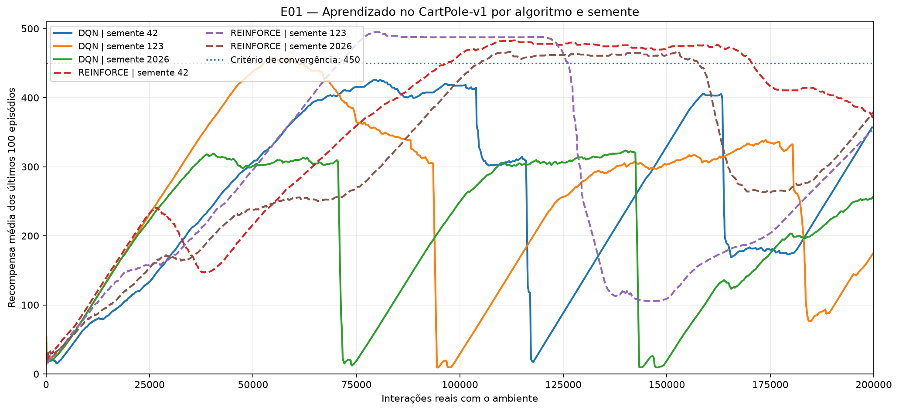
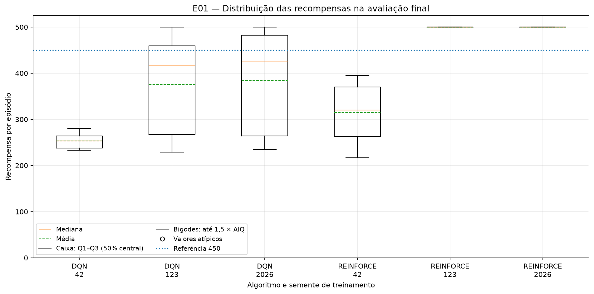
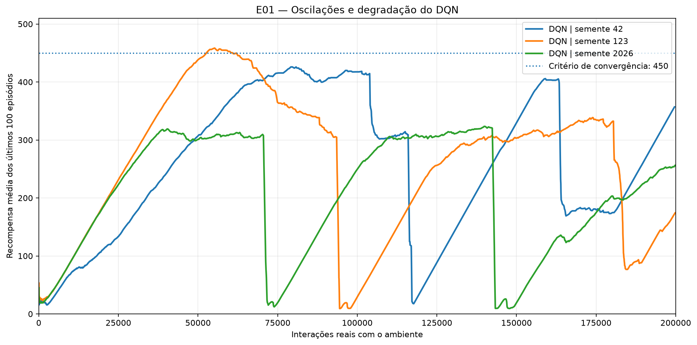
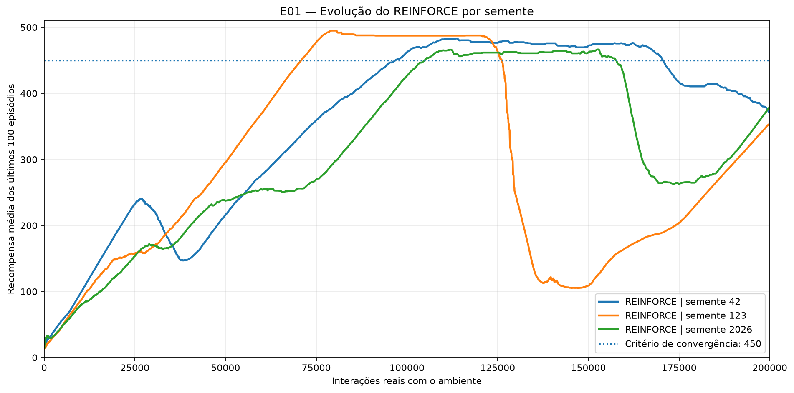
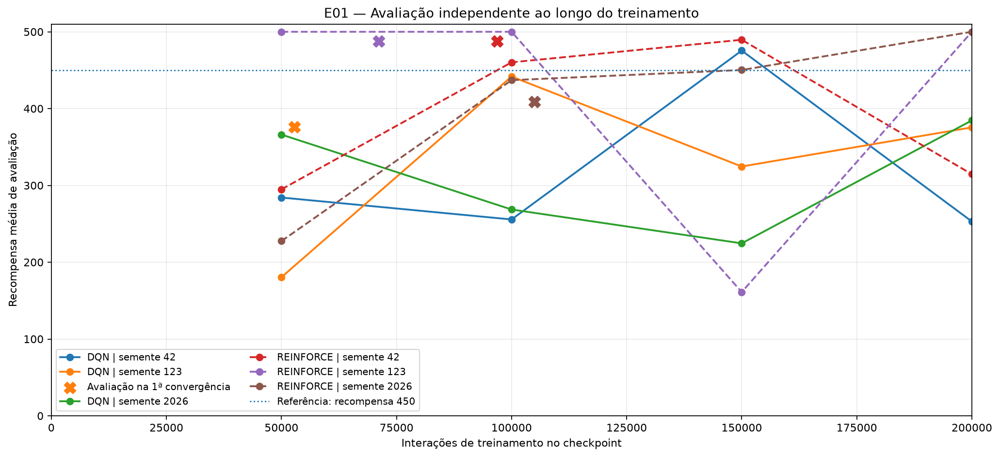
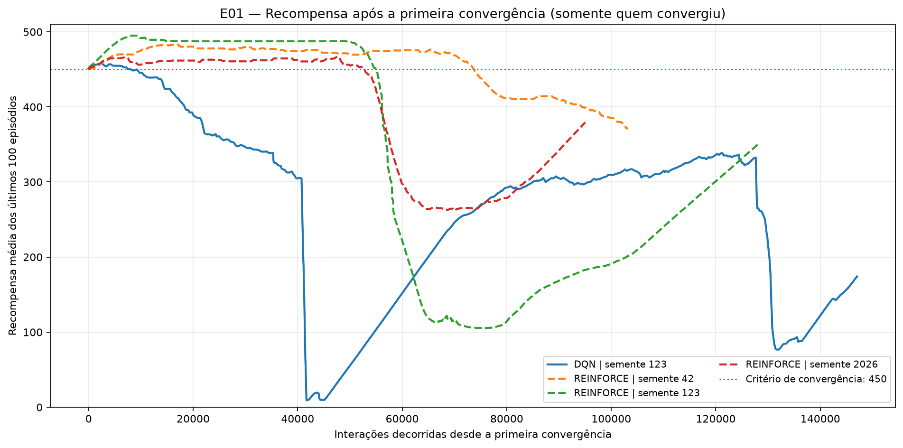

# Experimento E01 — DQN × REINFORCE no CartPole-v1

**Protocolo:** treinamento com orçamento fixo de 200.000 interações, sem parada antecipada por convergência  
**Execução:** 22 de novembro de 2026  
**Scripts:** `e01_cartpole.py` (execução) e `analise_e01.py` (análise)

## 1. Introdução

Este experimento compara duas abordagens de aprendizado por reforço profundo no ambiente CartPole-v1: **Deep Q-Network (DQN)**, baseada na estimação de valores de ação, e **REINFORCE**, baseada na otimização direta de uma política estocástica.

A primeira etapa do E01 utilizou uma regra de **parada antecipada quando a média de recompensa dos últimos 100 episódios atingia 450**. Essa decisão permitia comparar quantas interações eram necessárias para alcançar a meta e economizava processamento. Contudo, as oscilações observadas no DQN motivaram uma segunda etapa: investigar se as políticas continuariam apresentando bom desempenho **depois** de alcançarem o critério de convergência. Como o protocolo inicial encerrava esses treinamentos, não permitia observar esse comportamento ao longo de todo o orçamento.

Nesta etapa, a regra de convergência foi **preservada como marco de desempenho, mas deixou de encerrar o treinamento**. Os dois algoritmos executaram as mesmas 200.000 interações por semente. Foram acrescentadas avaliações independentes em checkpoints periódicos e na primeira convergência.

O objetivo é comparar **(i)** a ocorrência e a velocidade da primeira convergência, **(ii)** a evolução das recompensas ao longo do treinamento e **(iii)** a capacidade de preservar ou recuperar o desempenho durante o treinamento adicional. A hipótese exploratória é que **atingir o limiar de convergência não garante estabilidade posterior**, podendo ocorrer degradações e recuperações em ambos os métodos.

## 2. Fundamentação teórica

O **DQN** aproxima a função de valor de ação \(Q(s,a)\) por uma rede neural. Durante o treinamento, seleciona ações por uma política \(\varepsilon\)-greedy, armazena experiências em um *replay buffer* e atualiza a rede a partir de alvos de diferença temporal (TD). A implementação didática utilizada não emprega uma rede-alvo separada: o cálculo dos alvos utiliza a própria rede em atualização. Isso constitui uma característica relevante do código analisado, mas não permite, isoladamente, atribuir as oscilações a uma causa específica.

O **REINFORCE** é um método *on-policy* de gradiente de política. Ele parametriza diretamente a distribuição \(\pi_\theta(a\mid s)\) e ajusta seus parâmetros para aumentar a probabilidade de ações associadas a retornos descontados elevados. A versão empregada atualiza a rede em lotes de episódios completos, **sem baseline** para reduzir a variância das estimativas de gradiente.

Em ambos os métodos, uma recompensa média alta durante o treinamento não implica que o desempenho permanecerá alto após novas atualizações dos parâmetros. Também é necessário distinguir dois indicadores:

- **Média móvel de treinamento:** recompensa dos últimos 100 episódios completos coletados durante a aprendizagem, sob as respectivas políticas de interação.
- **Avaliação independente:** recompensa de uma política com pesos congelados em 20 episódios de um ambiente separado, sem atualização de parâmetros.

A primeira informa o desempenho recente durante o aprendizado; a segunda mede o comportamento de um checkpoint específico em condições de avaliação controladas. Os dois indicadores não são intercambiáveis.

As implementações de referência foram `Chapter11/01_cartpole_dqn.py` e `Chapter11/02_cartpole_reinforce.py`, do livro *Deep Reinforcement Learning Hands-On*, 3ª edição.

## 3. Metodologia experimental

O ambiente **CartPole-v1** fornece quatro variáveis contínuas de observação e duas ações discretas (aplicar força à esquerda ou à direita). Cada passo executado rende +1 de recompensa, com limite de **500 passos por episódio**.

Foram realizadas **seis execuções**: DQN e REINFORCE com as sementes **42, 123 e 2026**. O orçamento foi de **200.000 interações reais com o ambiente de treinamento em cada execução**; as interações utilizadas nas avaliações não entram nesse orçamento. No novo protocolo, `--no-stop-on-convergence`, **nenhuma execução é interrompida ao atingir a meta**.

A convergência foi definida como a **primeira ocorrência de média móvel ≥ 450 nos últimos 100 episódios completos**, exigindo ao menos 100 episódios. Esse marco é registrado mesmo quando a política posteriormente apresenta desempenho inferior. Para cada execução, foram registrados o histórico de episódios, a primeira convergência, o estado final e os checkpoints.

**Avaliações:** checkpoints em **50.000, 100.000, 150.000 e 200.000** interações; quando houve convergência, também foi salvo e avaliado um checkpoint específico naquele momento. Cada avaliação utilizou **20 episódios**, com sementes fixas **100000–100019** e sem atualização dos pesos. Na avaliação, o **DQN utiliza seleção gulosa** (`argmax Q`) e o **REINFORCE utiliza amostragem estocástica** da distribuição produzida pela rede. Para o REINFORCE, a avaliação usa geradores aleatórios locais, de modo a não alterar a sequência aleatória do treinamento. As mesmas sementes de avaliação foram reutilizadas entre checkpoints, favorecendo comparações controladas, mas os resultados desses checkpoints não são amostras independentes entre si.

Os hiperparâmetros permaneceram os das implementações didáticas do livro:

| Configuração | DQN | REINFORCE |
|---|---|---|
| Fator de desconto (γ) | 0,99 | 0,99 |
| Taxa de aprendizado | 0,002 | 0,01 |
| Atualização | Lotes de 8 experiências | Lotes de 4 episódios completos |
| Exploração durante o treino | ε-greedy; ε de 1,0 a 0,02 em 5.000 interações | Amostragem da política estocástica |
| Memória de experiências | Replay buffer de 50.000 | Sem replay buffer |
| Baseline / rede-alvo separada | Sem rede-alvo separada | Sem baseline |

A comparação utiliza o **mesmo orçamento de interações**, mas não iguala número de atualizações, arquitetura de otimização nem mecanismo de seleção das ações. Por isso, compara **as implementações de referência adotadas**, e não isola causalmente apenas a família do algoritmo.

A análise considerou somente os dados do diretório `results/e01/completo/no_stop_on_convergence/`, sem misturá-los aos resultados anteriores com parada antecipada. Foram empregados os arquivos CSV e JSON produzidos pelos scripts, e os gráficos exibem a evolução da média móvel e as avaliações dos checkpoints.

## 4. Resultados

### 4.1. Convergência e desempenho final

Todas as execuções completaram **200.000 interações**. O REINFORCE atingiu o critério de convergência nas **três sementes (3/3)**; o DQN, em **uma (1/3)**. A primeira convergência do DQN ocorreu antes das três primeiras convergências do REINFORCE.

| Algoritmo | Semente | Primeira convergência (interações) | Média móvel final do treino | Avaliação final: média ± DP (20 episódios) | Episódios de avaliação ≥ 450 |
|---|---:|---:|---:|---:|---:|
| DQN | 42 | Não atingiu | 356,95 | 253,00 ± 14,70 | 0/20 |
| DQN | 123 | 52.780 | 174,16 | 375,55 ± 99,00 | 6/20 |
| DQN | 2026 | Não atingiu | 256,04 | 384,60 ± 106,88 | 8/20 |
| REINFORCE | 42 | 96.822 | 371,34 | 314,55 ± 58,68 | 0/20 |
| REINFORCE | 123 | 71.128 | 352,42 | 500,00 ± 0,00 | 20/20 |
| REINFORCE | 2026 | 104.957 | 379,48 | 500,00 ± 0,00 | 20/20 |

A média das três recompensas médias de **avaliação final** foi de **337,72** para o DQN e **438,18** para o REINFORCE, diferença de **100,47 pontos** a favor do REINFORCE. Os desvios padrão **entre as médias das três sementes** foram, respectivamente, **73,51** e **107,07** pontos. Esses valores são descritivos: há apenas três treinamentos independentes por algoritmo.

Nas 60 avaliações finais por algoritmo, **14/60 episódios** do DQN e **40/60 episódios** do REINFORCE alcançaram pelo menos 450 pontos. O REINFORCE obteve exatamente **500 pontos nos 40 episódios** correspondentes às sementes 123 e 2026. Isso demonstra desempenho máximo **nessas condições específicas de avaliação**, não estabilidade garantida em qualquer episódio ou ao longo de todo o treinamento.

### 4.2. Curvas de aprendizado ao longo das 200.000 interações — Gráfico 01

O **Gráfico 01** evidencia que as trajetórias não foram monotônicas. O DQN apresentou várias quedas abruptas, mas também recuperações. O REINFORCE apresentou crescimento inicial relativamente consistente nas três sementes, seguido por degradações importantes na segunda metade do treinamento. Em particular, as trajetórias do REINFORCE nas sementes 123 e 2026 caíram expressivamente **depois de já terem superado 450 pontos**.

Assim, o treinamento completo responde a uma questão que a etapa com parada antecipada deixava em aberto: **a primeira convergência não representou estabilização definitiva da recompensa de treinamento**.

### 4.3. Distribuição das avaliações finais — Gráfico 02

O **Gráfico 02** permite observar a dispersão que a média esconde. O DQN apresentou recompensa final baixa e relativamente concentrada na semente 42; nas sementes 123 e 2026, houve dispersão maior entre os episódios. O REINFORCE, por sua vez, obteve recompensa **500 em todos os 20 episódios** nas sementes 123 e 2026, produzindo caixas de altura nula no gráfico. A semente 42 do REINFORCE terminou com avaliação consideravelmente inferior, de **314,55 ± 58,68**.

Consequentemente, a média final superior do REINFORCE não corresponde a comportamento uniforme entre sementes: houve **duas avaliações finais perfeitas e uma substancialmente inferior**.

### 4.4. Oscilações e degradação do DQN — Gráfico 03

No **Gráfico 03**, todas as sementes do DQN apresentaram degradação após períodos de melhora:

| Semente | Maior média móvel observada | Interações do pico | Menor média móvel após o pico |
|---|---:|---:|---:|
| 42 | 425,90 | 79.158 | 17,57 |
| 123 | 458,44 | 55.233 | 9,24 |
| 2026 | 323,38 | 139.859 | 9,32 |

Na semente **123**, a primeira convergência ocorreu em **52.780 interações**, com média móvel de **451,05**. Continuar o treino revelou queda até **9,24**, seguida de recuperação parcial. A média móvel final ficou em **174,16**, bem abaixo do limiar de 450. Nas sementes **42** e **2026**, o critério de convergência não foi atingido durante o treino, embora ambas também tenham exibido períodos de melhora e degradação.

Essas trajetórias descrevem instabilidade **da implementação de DQN utilizada**. O experimento não identifica qual componente da implementação causou as quedas.

### 4.5. Evolução do REINFORCE após a convergência — Gráfico 04

O **Gráfico 04** mostra que todas as três sementes atingiram a meta, porém **nenhuma preservou média móvel ≥ 450 até o fim do treinamento**. Os principais extremos observados foram:

| Semente | Primeira convergência | Pico da média móvel | Menor média móvel após a primeira convergência | Média móvel final |
|---|---:|---:|---:|---:|
| 42 | 96.822 | 483,21 | 371,34 | 371,34 |
| 123 | 71.128 | 495,00 | 105,37 | 352,42 |
| 2026 | 104.957 | 466,43 | 261,97 | 379,48 |

A queda mais expressiva ocorreu na semente **123**, cuja média móvel chegou a **495,00**, caiu a **105,37** por volta de 145.402 interações e voltou a crescer posteriormente. A semente **2026** também caiu consideravelmente, enquanto a semente **42** apresentou degradação mais gradual perto do fim.

Portanto, a execução sem parada permite constatar algo que não poderia ser concluído no protocolo anterior: **o REINFORCE também apresentou instabilidade após a primeira convergência**.

### 4.6. Avaliações independentes dos checkpoints — Gráfico 05

O **Gráfico 05** compara políticas congeladas nos mesmos marcos de treinamento. As médias das avaliações de 20 episódios em cada checkpoint periódico foram:

| Algoritmo | Semente | 50.000 | 100.000 | 150.000 | 200.000 |
|---|---:|---:|---:|---:|---:|
| DQN | 42 | 284,20 | 255,65 | 475,50 | 253,00 |
| DQN | 123 | 180,45 | 441,70 | 324,60 | 375,55 |
| DQN | 2026 | 366,15 | 268,60 | 224,55 | 384,60 |
| REINFORCE | 42 | 294,85 | 460,25 | 489,60 | 314,55 |
| REINFORCE | 123 | 500,00 | 500,00 | 161,10 | 500,00 |
| REINFORCE | 2026 | 227,50 | 437,00 | 450,25 | 500,00 |

O resultado mais expressivo é o do **REINFORCE, semente 123**: avaliação máxima em **50.000** e **100.000** interações, colapso para **161,10** em **150.000** e recuperação para **500,00** em **200.000**. O REINFORCE da semente 42 passou de **489,60** (150.000) para **314,55** (200.000). No DQN, a semente 42 obteve **475,50** aos 150.000 passos e **253,00** ao final.

Há também divergências entre os indicadores: o **DQN da semente 42**, embora não tenha alcançado média móvel de treinamento ≥ 450, obteve **475,50 na avaliação** aos 150.000 passos. Da mesma forma, o **REINFORCE da semente 123** já alcançava **500,00 na avaliação aos 50.000 passos**, antes da primeira convergência segundo o critério de treinamento (71.128 passos). Isso não é contradição: o critério usa episódios de treino, enquanto a avaliação mede uma política congelada em 20 episódios específicos.

### 4.7. Comparação após a primeira convergência — Gráfico 06

O **Gráfico 06** alinha as quatro execuções que atingiram a meta pelo número de interações decorridas **desde a primeira convergência**. O DQN da semente 123 e as três sementes do REINFORCE voltaram a apresentar média móvel inferior a 450 depois desse marco. O gráfico torna evidente que a degradação pode ocorrer em momentos e intensidades diferentes, mesmo quando a comparação parte de um valor inicial próximo do limiar.

Para distinguir degradação do treinamento e mudança no desempenho da política avaliada, comparam-se abaixo os checkpoints da **primeira convergência** e do **final do orçamento**:

| Algoritmo | Semente | Interações na primeira convergência | Avaliação na primeira convergência | Avaliação final (200.000) | Variação final − primeira |
|---|---:|---:|---:|---:|---:|
| DQN | 123 | 52.780 | 376,05 | 375,55 | −0,50 |
| REINFORCE | 42 | 96.822 | 487,65 | 314,55 | −173,10 |
| REINFORCE | 123 | 71.128 | 487,90 | 500,00 | +12,10 |
| REINFORCE | 2026 | 104.957 | 409,00 | 500,00 | +91,00 |

No **DQN, semente 123**, avaliações inicial e final semelhantes poderiam sugerir estabilidade se apenas esses dois momentos fossem observados, mas os gráficos 03, 05 e 06 documentam quedas intermediárias significativas. No **REINFORCE, semente 123**, a avaliação final melhorou apesar do colapso registrado aos 150.000 passos. Já na **semente 42 do REINFORCE**, a avaliação final foi muito inferior à da primeira convergência. Portanto, **nem a primeira convergência nem a avaliação final isoladamente descrevem toda a trajetória**.

## 5. Discussão

**Convergência inicial e estabilidade são propriedades distintas.** O REINFORCE manteve a vantagem observada na etapa anterior quanto à frequência de primeira convergência (**3/3 contra 1/3**). Contudo, o treinamento completo demonstrou que suas políticas também podem sofrer degradação posterior. A expressão “convergiu”, neste experimento, significa **atingiu o limiar ao menos uma vez**; não significa que permaneceu acima dele.

**O DQN apresentou degradações profundas, incluindo depois de convergir.** O caso da semente 123 é particularmente informativo: a política atingiu a meta mais rapidamente que qualquer execução do REINFORCE, mas a média móvel caiu de valores superiores a 450 para **9,24**. Nas outras sementes, embora o limiar não tenha sido atingido, também ocorreram quedas pronunciadas. São comportamentos compatíveis com instabilidade de aprendizado, mas o desenho atual não identifica suas causas. A ausência de rede-alvo separada, as escolhas de taxa de aprendizado e a dinâmica de atualização são fatores que poderiam ser investigados em experimentos específicos.

**O REINFORCE não foi uniformemente estável nem uniformemente superior.** As sementes 123 e 2026 terminaram com avaliação perfeita nos 20 episódios, mas a semente 42 caiu de **487,65** na primeira convergência para **314,55** no final. A semente 123 passou por um checkpoint com avaliação de **161,10** antes de recuperar 500. Assim, o bom resultado final médio conviveu com instabilidade importante ao longo da trajetória.

**A análise por checkpoints acrescentou informação não capturada pelas curvas de treinamento.** O valor de 500 no checkpoint de 50.000 passos do REINFORCE (semente 123) ocorreu antes da convergência definida pela média móvel do treino, e o DQN (semente 42) superou 450 em uma avaliação intermediária sem atingir esse limiar no treinamento. Isso reforça a importância de relatar explicitamente qual indicador define convergência e qual indicador caracteriza o desempenho de uma política congelada.

**A decisão metodológica de retirar a parada foi produtiva.** A parada antecipada da primeira etapa era adequada para estudar o **tempo até a primeira convergência**. Nesta segunda etapa, deliberadamente mantivemos o treino até 200.000 interações para investigar a **persistência do desempenho**. A extensão não invalida os resultados anteriores: ela responde a uma pergunta que o protocolo anterior, por decisão de desenho, não pretendia testar integralmente.

**Limitações.** Foram utilizados somente três treinamentos independentes por algoritmo; não se aplicaram testes de significância. Os 20 episódios por checkpoint reutilizam as mesmas sementes e, portanto, são adequados a uma comparação controlada, mas não equivalem a 20 treinamentos independentes. Os algoritmos diferem em hiperparâmetros, frequência de atualização e política de avaliação (DQN guloso, REINFORCE estocástico); logo, a comparação não estabelece superioridade geral de uma família sobre outra. Finalmente, os checkpoints demonstram desempenho **nos marcos amostrados**, não continuamente entre eles; as curvas de treinamento fornecem uma medida complementar.

## 6. Conclusões

O segundo protocolo do E01 completou **200.000 interações por execução** e mostrou que a primeira convergência **não garante estabilidade posterior**, tanto no DQN quanto no REINFORCE.

O **REINFORCE** alcançou o critério de convergência nas três sementes e apresentou melhor média de recompensa na avaliação final (**438,18 contra 337,72**). Entretanto, sofreu degradações relevantes após a convergência; em uma semente, a avaliação caiu **173,10 pontos** entre a primeira convergência e o final, e, em outra, houve colapso intermediário seguido de recuperação completa na avaliação. O **DQN** atingiu a meta em uma semente e exibiu quedas profundas e recuperações parciais durante a execução prolongada.

O principal resultado metodológico é que **eficiência para atingir uma meta, estabilidade durante a continuidade do treinamento e qualidade da política final precisam ser avaliadas separadamente**. A introdução dos checkpoints periódicos permitiu caracterizar esses três aspectos sem depender apenas do resultado final ou da média móvel de treinamento.

Os resultados sustentam essas conclusões **para as implementações, configurações e sementes examinadas**, sem permitir atribuir causalmente as oscilações a um componente específico nem afirmar superioridade universal entre DQN e REINFORCE.

---

**Fonte dos dados:** `resumo_execucoes.csv`, `resumo_algoritmos.csv`, `resumo_checkpoints.csv`, `avaliacoes_checkpoints.csv`, `episodios_treinamento.csv`, `episodios_avaliacao.csv`, `resumo_analise.json` e os seis gráficos fornecidos para a execução sem parada por convergência. As figuras são referenciadas por caminhos relativos para que este arquivo Markdown possa ser mantido no mesmo diretório dos arquivos `.png`.
