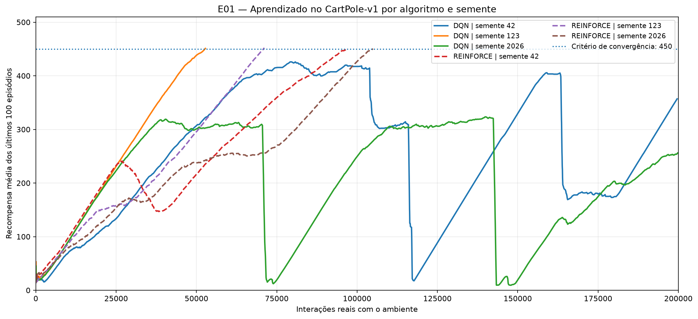
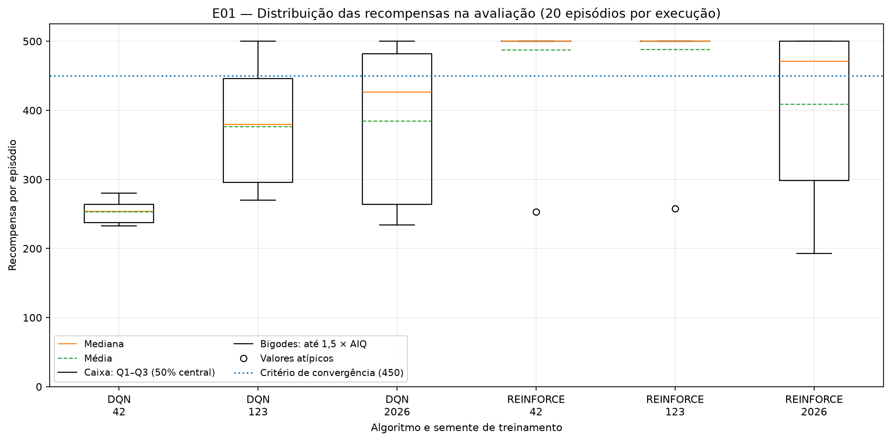
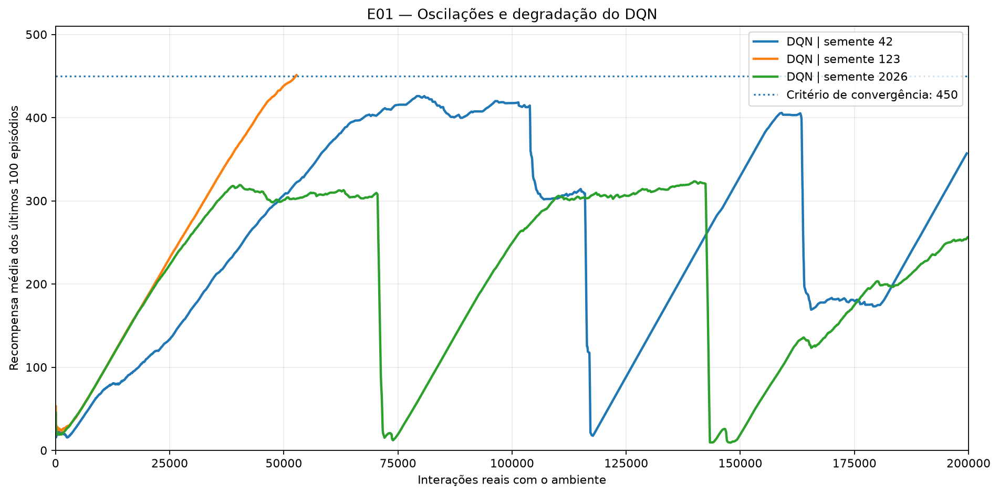
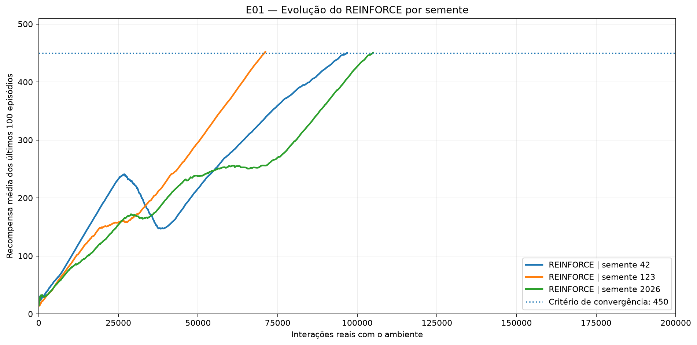

# Experimento E01 — DQN × REINFORCE no CartPole-v1

## 1. Introdução

**Objetivo:** comparar o comportamento de uma abordagem baseada em valor (DQN) com o método de gradiente de política REINFORCE, em termos de aprendizado, convergência e avaliação independente.

**Hipótese inicial:** ambos conseguem aprender no CartPole-v1, mas podem diferir na velocidade de convergência, estabilidade do treinamento e eficiência de amostragem.

## 2. Fundamentação teórica

- **DQN:** aproxima valores de ação Q(s,a), utiliza exploração ε-greedy, replay buffer e atualizações por erro TD. A implementação didática empregada **não possui uma rede-alvo separada**.
- **REINFORCE:** aprende diretamente uma distribuição de ações e atualiza seus parâmetros a partir de retornos descontados ao término de episódios; a implementação utilizada não emprega baseline.

Os algoritmos foram reutilizados a partir de `Chapter11/01_cartpole_dqn.py` e `Chapter11/02_cartpole_reinforce.py`. O executor de controle e registro foi `e01_cartpole.py`.

## 3. Metodologia experimental

- Ambiente: `CartPole-v1`, com recompensas de +1 por passo e limite de 500 passos por episódio.
- Sementes de treinamento: **42, 123, 2026** para cada algoritmo.
- Limite: **200.000 interações reais** com o ambiente por execução.
- Convergência: média móvel de recompensa **≥ 450** nos últimos **100 episódios completos**; interrupção ao alcançar esse limiar.
- Avaliação independente: **20 episódios** em novo ambiente, com sementes **100000–100019**, sem otimização dos pesos.
- Ações na avaliação: política **gulosa** (`argmax Q`) no DQN e **amostragem estocástica** da política no REINFORCE.
- Sinal de aprendizado: média dos últimos 100 episódios, plotada em função das interações com o ambiente.
- Bibliotecas registradas nos resultados: Python 3.11.15, PyTorch 2.5.0, Gymnasium 0.29.1 e NumPy 1.26.4.
- Hiperparâmetros dos códigos do livro: DQN com γ=0,99, lr=0,002, batch=8, ε de 1,0 até 0,02 ao longo de 5.000 interações, replay buffer=50.000; REINFORCE com γ=0,99, lr=0,01 e lote de 4 episódios completos.

O protocolo usa o mesmo teto de interações, mas não impõe os mesmos hiperparâmetros ou número de atualizações; essa é uma comparação de **implementações de referência**, não um experimento de ablação que isole exclusivamente o algoritmo.

## 4. Resultados

### 4.1. Resultados por execução

| Algoritmo | Semente | Convergiu | Interações de treino | Recompensa na avaliação (média ± DP) | Episódios de avaliação ≥ 450 / 20 |
|---|---:|:---:|---:|---:|---:|
| DQN | 42 | Não | 200000 | 253.00 ± 14.70 | 0/20 |
| DQN | 123 | Sim | 52780 | 376.05 ± 77.01 | 5/20 |
| DQN | 2026 | Não | 200000 | 384.60 ± 106.88 | 8/20 |
| REINFORCE | 42 | Sim | 96822 | 487.65 ± 55.23 | 19/20 |
| REINFORCE | 123 | Sim | 71128 | 487.90 ± 54.11 | 19/20 |
| REINFORCE | 2026 | Sim | 104957 | 409.00 ± 107.84 | 11/20 |

**Convergência:** REINFORCE em **3/3** execuções, DQN em **1/3**. Os passos até a convergência foram: REINFORCE semente 42 = 96.822, semente 123 = 71.128, semente 2026 = 104.957; DQN semente 123 = 52.780. As duas demais execuções do DQN terminaram no teto de 200.000 passos, portanto seu tempo até convergência é **não observado (censurado)**.

**Avaliação final:** média das três médias por semente = **461.52** para REINFORCE e **337.88** para DQN, diferença de **123.63**. O desempenho médio do REINFORCE foi superior em todas as três sementes, mas a amostra é pequena (três execuções independentes por algoritmo). O desvio padrão nos resultados por semente foi de **45.48** e **73.64**, respectivamente.

Na avaliação, **49/60** episódios do REINFORCE e **13/60** episódios do DQN obtiveram recompensa ≥ 450. Exatamente 500 pontos foram alcançados em **46/60** episódios no REINFORCE e **6/60** no DQN. Essas frequências descrevem os episódios observados e **não** são 60 treinamentos independentes.

### 4.2. Curvas de aprendizado

### 4.3. Distribuição das recompensas na avaliação

### 4.4. Instabilidade do DQN

Os maiores valores de média móvel no DQN foram: semente 42 = **425,90** por volta de 79.158 interações; semente 123 = **451,05** em 52.780 interações (critério de parada); semente 2026 = **323,38** por volta de 139.859 interações. Em 42 e 2026, o desempenho caiu após avanços expressivos. Na semente 2026, a média móvel chegou a apenas **9,32** depois do pico, evidenciando degradação substancial.

### 4.5. Evolução e oscilações do REINFORCE

O Gráfico 04 apresenta a evolução da recompensa média móvel dos últimos 100 episódios para as três sementes do REINFORCE. Todas atingiram o limiar de convergência de **450 pontos**, mas com trajetórias distintas. A semente **123** convergiu primeiro, com **71.128 interações**, seguida pelas sementes **42** (**96.822**) e **2026** (**104.957**). A semente **42** apresentou uma queda intermediária da média móvel após alcançar aproximadamente 240 pontos, antes de retomar o crescimento; a semente **2026** apresentou um período de avanço mais lento, em torno de 250 pontos, antes de acelerar novamente. Portanto, o aprendizado do REINFORCE também não foi estritamente monotônico, embora nenhuma dessas oscilações tenha impedido a convergência dentro do orçamento definido.

As curvas terminam ao atingir o critério de parada. Assim, o gráfico demonstra a **consistência na obtenção da convergência** nas três sementes, mas **não permite avaliar a estabilidade do REINFORCE após convergir**, nem comparar diretamente sua estabilidade de longo prazo com a do DQN, cujas execuções não convergentes continuaram até 200.000 interações.

## 5. Discussão

1. **O REINFORCE atingiu a convergência em todas as sementes** e alcançou maior média de avaliação, nos limites deste desenho experimental. O Gráfico 04 mostra que houve oscilações durante o aprendizado, especialmente na semente 42, embora as três trajetórias tenham alcançado o limiar estabelecido.
2. **O DQN aprendeu, mas não de modo monotônico.** As quedas relevantes nas sementes 42 e 2026 são compatíveis com problemas de estabilidade em uma implementação simples de DQN, mas não demonstram sua causa exata. A ausência de rede-alvo separada é um mecanismo potencialmente relevante que merece análise posterior.
3. **O DQN da semente 123 atingiu a meta mais rapidamente**, em 52.780 interações, porém a recompensa média da avaliação foi 376,05, inferior à média móvel de treinamento que acionou a parada. O REINFORCE da semente 2026 também apresentou diferença importante entre a média móvel de parada (450,47) e a avaliação (409,00). **A meta de treino não implica desempenho equivalente na avaliação.**
4. **A comparação de estabilidade tem uma limitação central:** o REINFORCE foi interrompido assim que atingiu a meta, entre 71 mil e 105 mil passos. As execuções DQN que não convergiram prosseguiram até 200 mil, expondo-as a mais oportunidades de degradação. Portanto, o experimento não demonstra que o REINFORCE permaneceria estável após treinamento adicional até o mesmo teto.
5. **As políticas de avaliação são diferentes** por definição dos métodos implementados: DQN guloso e REINFORCE estocástico; a comparação representa o uso padrão adotado neste executor, não políticas idênticas de seleção de ações.
6. **O número de atualizações não é diretamente comparável:** o DQN otimiza aproximadamente a cada interação; REINFORCE, a cada quatro episódios completos.
7. **Qualidade dos registros:** foram encontrados seis históricos completos de treinamento e seis arquivos de avaliação com 20 episódios cada; as médias móveis e as estatísticas informadas nos JSONs foram recalculadas e conferidas com os CSVs. Os passos marcados nas linhas de fim de episódio apresentam um deslocamento constante de duas interações em relação à soma acumulada das recompensas, relacionado ao início do fluxo de experiências; a contagem final é feita no wrapper de `env.step()` e o deslocamento não altera os achados substantivos.

## 6. Conclusões

Nos experimentos executados, o REINFORCE demonstrou maior taxa de convergência entre as três sementes e melhor avaliação final do que a implementação didática do DQN. O DQN convergiu em uma execução e exibiu quedas marcantes nas outras duas. Os resultados dão suporte à análise do capítulo 11, mas não autorizam conclusões universais sobre superioridade entre os algoritmos.

**Possível aprofundamento metodológico (não executado):** para investigar estabilidade após a primeira convergência em condições mais equilibradas, retirar temporariamente a parada antecipada e avaliar checkpoints em marcos fixos de interações para ambos os métodos. O E01 atual está encerrado como experimento exploratório; essa extensão seria distinta.

---

**Fonte dos dados:** `e01-resultados.tar.gz` fornecido pelo aluno, somente execuções com `max_training_steps=200000`. As duas execuções piloto de 5.000 passos presentes no arquivo não foram incorporadas às estatísticas deste relatório.
