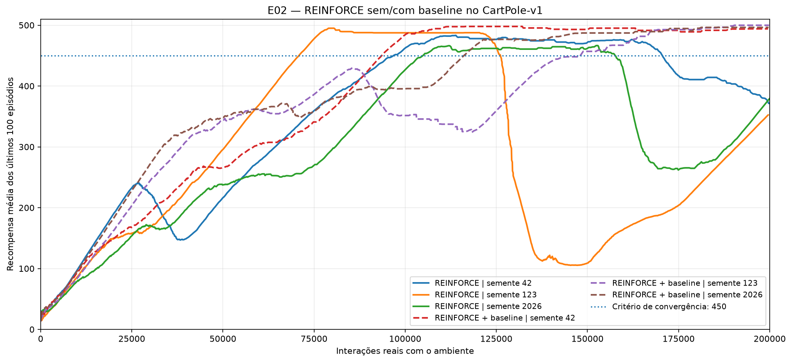
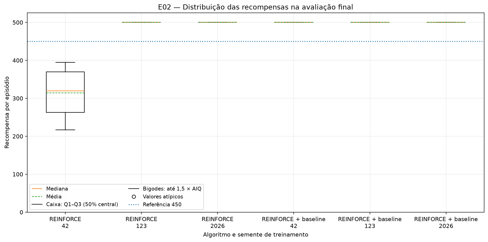
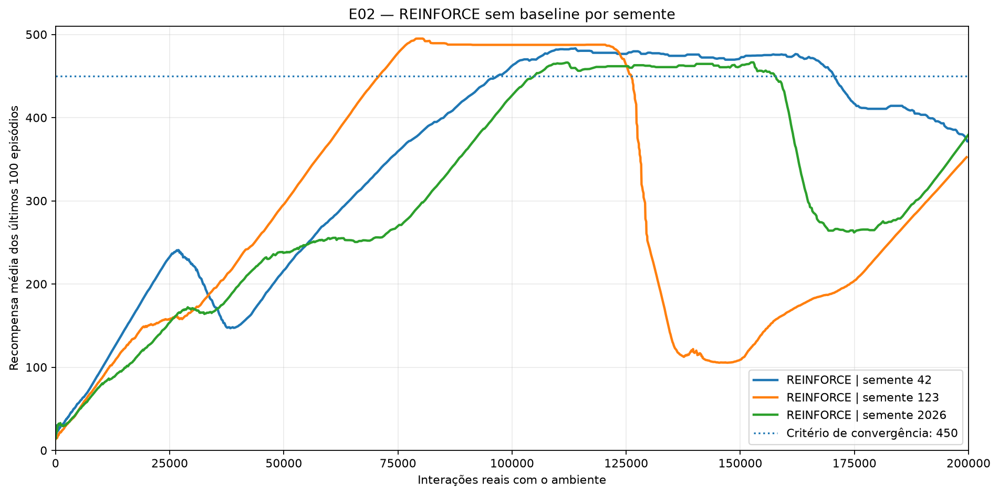
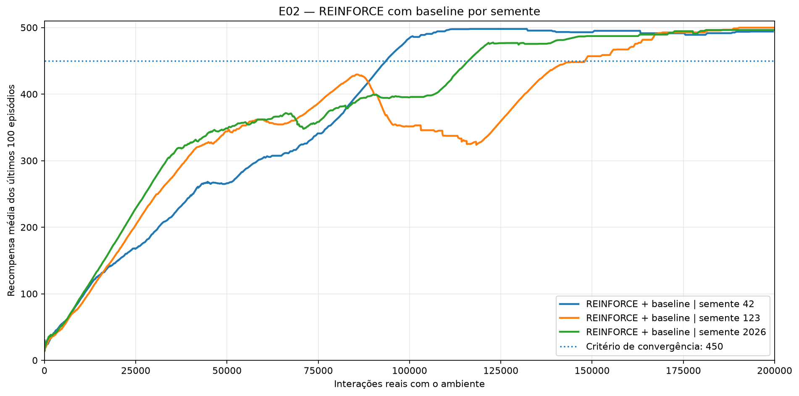
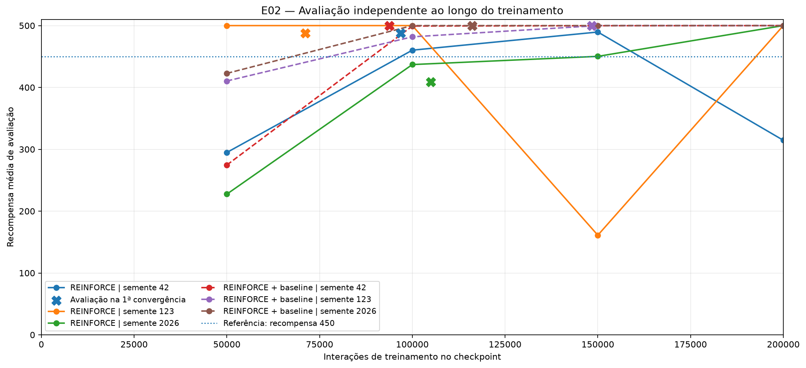
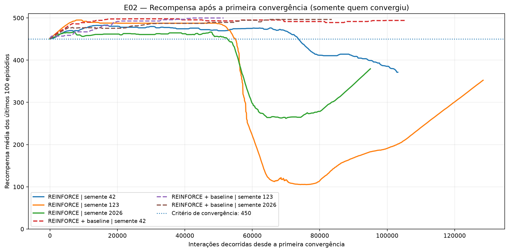

# Experimento E02 — REINFORCE com e sem baseline no CartPole-v1

**Protocolo:** 200.000 interações de treinamento por execução, sem parada antecipada por convergência  
**Data:** 22 de novembro de 2026  
**Scripts:** `e02_cartpole.py` (execução) e `analise_e02.py` (análise)

## 1. Introdução

O experimento E02 investiga o efeito da introdução de um **baseline** no algoritmo de gradiente de política REINFORCE, utilizando o ambiente **CartPole-v1**. A comparação parte dos exemplos do capítulo 11 de *Deep Reinforcement Learning Hands-On* (3ª edição): a implementação convencional do REINFORCE e uma variante que centraliza os retornos descontados de cada episódio antes de calcular a atualização da política.

No E01, a execução do REINFORCE sem parada antecipada mostrou que atingir uma recompensa média elevada não assegura sua manutenção ao longo de novas atualizações. Isso motivou a avaliação de uma modificação proposta no material didático: o uso de um baseline, cujo propósito é tornar menos variáveis os sinais utilizados na atualização da política.

O objetivo deste experimento é comparar **(i)** a velocidade até a primeira convergência, **(ii)** a evolução das recompensas durante as 200.000 interações, **(iii)** a estabilidade após a primeira convergência e **(iv)** o desempenho de políticas avaliadas independentemente em checkpoints. A hipótese exploratória é que a centralização dos retornos favoreça a **estabilidade do desempenho**, ainda que não necessariamente acelere a primeira convergência.

## 2. Fundamentação teórica

O **REINFORCE** é um algoritmo *on-policy* de gradiente de política. A rede parametriza uma distribuição de probabilidades de ações, \(\pi_\theta(a\mid s)\), e suas atualizações utilizam os retornos descontados \(G_t\) observados ao longo de episódios completos. A contribuição de cada ação para a função de perda é proporcional ao produto entre seu retorno e o logaritmo de sua probabilidade:

\[
L_{\text{REINFORCE}}(\theta)=-\frac{1}{N}\sum_t G_t\log\pi_\theta(a_t\mid s_t).
\]

A variante **REINFORCE com baseline** substitui o retorno \(G_t\) pelo retorno centralizado \(G_t-b\). Na implementação específica do livro, \(b\) é a **média dos retornos descontados calculados dentro do próprio episódio**:

\[
b=\overline{G}_{\text{episódio}}=\frac{1}{T}\sum_{t=0}^{T-1}G_t,
\qquad
L_{\text{baseline}}(\theta)=-\frac{1}{N}\sum_t(G_t-\overline{G}_{\text{episódio}})\log\pi_\theta(a_t\mid s_t).
\]

Esse procedimento procura diminuir a amplitude e a variabilidade dos pesos associados às ações: retornos acima da média do episódio recebem contribuição positiva, enquanto retornos abaixo da média recebem contribuição negativa. **Não há rede crítica nem estimação aprendida de \(V(s)\)**, como ocorreria em um método *actor-critic*. A média calculada a partir da própria trajetória também não deve ser confundida automaticamente com um baseline independente da ação, utilizado na demonstração clássica de não introdução de viés.

O efeito da centralização sobre a **variância dos gradientes**, entretanto, não pode ser estabelecido apenas observando curvas de recompensa. Neste E02 são medidos resultados comportamentais de aprendizado; a medição direta da variabilidade das atualizações fica reservada ao E03.

As implementações de referência são `Chapter11/02_cartpole_reinforce.py` e `Chapter11/03_cartpole_reinforce_baseline.py`.

## 3. Metodologia experimental

O **CartPole-v1** fornece quatro componentes contínuos de observação e duas ações discretas. Cada interação bem-sucedida rende **+1**, e um episódio pode acumular até **500 pontos**.

Foram realizadas **seis execuções independentes**, combinando as duas variantes do REINFORCE com as sementes **42, 123 e 2026**. Cada execução completou **200.000 interações com o ambiente de treinamento**. Foi utilizado o parâmetro `--no-stop-on-convergence`: a primeira convergência foi registrada como indicador, mas **não interrompeu o treinamento**.

Definiu-se a primeira convergência como a primeira ocasião em que a **recompensa média dos últimos 100 episódios completos de treinamento** atingiu **450 pontos ou mais**, após pelo menos 100 episódios. Esse indicador caracteriza uma ocorrência no histórico de treinamento; não representa convergência assintótica nem garante estabilidade posterior.

O protocolo incluiu avaliações independentes em **50.000, 100.000, 150.000 e 200.000 interações**, além de uma avaliação específica no instante da primeira convergência. Cada avaliação executou **20 episódios**, com os pesos congelados e sem atualizações. Ambas as variantes utilizaram **seleção estocástica de ações** e as mesmas sementes de avaliação (**100000–100019**) em todos os checkpoints. As interações de avaliação não integraram o orçamento de treinamento.

As duas variantes mantiveram a arquitetura e os hiperparâmetros das implementações didáticas:

| Configuração | REINFORCE | REINFORCE + baseline |
|---|---|---|
| Fator de desconto \(\gamma\) | 0,99 | 0,99 |
| Taxa de aprendizado | 0,01 | 0,01 |
| Otimizador | Adam | Adam |
| Atualização | A cada 4 episódios completos | A cada 4 episódios completos |
| Seleção de ações no treino e na avaliação | Estocástica | Estocástica |
| Sinal usado na atualização | Retorno descontado \(G_t\) | \(G_t-\overline G_{\text{episódio}}\) |
| Orçamento | 200.000 interações | 200.000 interações |

O experimento foi executado por `e02_cartpole.py` e analisado por `analise_e02.py`, utilizando exclusivamente os dados de `results/e02/completo/no_stop_on_convergence/`. As médias e desvios-padrão das avaliações referem-se aos **20 episódios de cada checkpoint**. Os desvios-padrão entre sementes são apresentados separadamente, pois episódios de avaliação não equivalem a treinamentos independentes. Os checkpoints usam sementes de avaliação repetidas para favorecer a comparação controlada, de modo que seus resultados não são independentes entre si.

## 4. Resultados

### 4.1. Primeira convergência e avaliação final

Todas as seis execuções completaram o orçamento e atingiram o limiar de convergência ao menos uma vez (**3/3 por variante**). O REINFORCE sem baseline atingiu a primeira convergência com **90.969 interações, em média**, enquanto a versão com baseline precisou de **119.439 interações**, aproximadamente **31,3% a mais**.

| Variante | Semente | Primeira convergência (interações) | Média móvel final do treino | Avaliação final: média ± DP (20 episódios) | Avaliações finais ≥ 450 |
|---|---:|---:|---:|---:|---:|
| Sem baseline | 42 | 96.822 | 371,34 | 314,55 ± 58,68 | 0/20 |
| Sem baseline | 123 | 71.128 | 352,42 | 500,00 ± 0,00 | 20/20 |
| Sem baseline | 2026 | 104.957 | 379,48 | 500,00 ± 0,00 | 20/20 |
| Com baseline | 42 | 93.844 | 494,00 | 500,00 ± 0,00 | 20/20 |
| Com baseline | 123 | 148.334 | 499,86 | 500,00 ± 0,00 | 20/20 |
| Com baseline | 2026 | 116.138 | 496,32 | 500,00 ± 0,00 | 20/20 |

A média das recompensas médias de **avaliação final**, considerando as três sementes, foi **438,18** sem baseline e **500,00** com baseline, uma diferença de **61,82 pontos**. O desvio-padrão **entre as três médias finais por semente** foi, respectivamente, **107,07** e **0,00**. Assim, a variante com baseline alcançou **500 pontos nos 60 episódios de avaliação final**, enquanto a versão convencional alcançou 500 pontos em **40 dos 60 episódios**.

A diferença na velocidade de convergência não foi uniforme: com baseline, a semente 42 convergiu **2.978 interações antes**; a semente 123, **77.206 interações depois**; e a semente 2026, **11.181 interações depois**. Portanto, o resultado agregado não implica que a variante convencional tenha sido mais rápida em todas as sementes.

### 4.2. Curvas de aprendizado — Gráfico 01

O **Gráfico 01** mostra um comportamento inicial de crescimento para ambas as variantes, seguido de trajetórias diferentes. O REINFORCE convencional apresentou quedas relevantes na segunda metade do treinamento, particularmente nas sementes **123**, após cerca de 125 mil interações, e **2026**, após aproximadamente 160 mil. Na semente **42**, houve redução mais gradual ao final.

Com baseline, as três trajetórias permaneceram em níveis elevados depois de alcançarem o limiar de 450. A semente 123, embora tenha convergido mais tarde, terminou com média móvel próxima de 500. A comparação sugere uma vantagem do baseline na **manutenção do desempenho após a primeira convergência**, mais pronunciada do que qualquer vantagem na rapidez inicial.

### 4.3. Distribuição das avaliações finais — Gráfico 02

O **Gráfico 02** evidencia que as três execuções com baseline alcançaram **500 pontos em todos os 20 episódios de avaliação final**; por isso, seus boxplots aparecem como linhas na recompensa máxima. O mesmo ocorreu com o REINFORCE convencional nas sementes 123 e 2026, mas não na semente 42, cuja média final foi **314,55** e cujas recompensas ficaram abaixo de 400.

A ausência de dispersão entre os episódios das avaliações finais com baseline descreve os **60 testes realizados nesses checkpoints**, não assegura que a política seja perfeita para quaisquer estados iniciais ou que não tenha havido oscilações anteriores.

### 4.4. REINFORCE sem baseline — Gráfico 03

No **Gráfico 03**, todas as sementes atingiram pelo menos uma vez a média móvel de 450, mas **todas voltaram a apresentar valores inferiores ao limiar**. O caso mais expressivo foi a semente **123**: a média móvel alcançou **495,00** e posteriormente caiu para **105,37**, antes de iniciar uma recuperação. A semente 2026 caiu até **261,97** depois da primeira convergência; a semente 42 terminou em **371,34**.

O desempenho final da semente 123 em avaliação foi perfeito apesar da forte queda intermediária no treinamento. Assim, a avaliação final isolada teria ocultado o episódio de degradação.

### 4.5. REINFORCE com baseline — Gráfico 04

O **Gráfico 04** apresenta uma trajetória distinta: mesmo com oscilações anteriores à primeira convergência — notadamente na semente 123 —, as três execuções com baseline permaneceram acima de 450 após atingir esse limiar pela primeira vez.

Os menores valores da média móvel **após a primeira convergência** foram **451,83** (semente 42), **452,53** (123) e **450,15** (2026). As médias móveis finais foram **494,00**, **499,86** e **496,32**, respectivamente.

Esse resultado caracteriza **estabilidade do desempenho de treinamento no intervalo observado**, sem demonstrar por si só menor variância dos gradientes.

### 4.6. Avaliações independentes ao longo do treinamento — Gráfico 05

O **Gráfico 05** acrescenta avaliações com políticas congeladas, complementando as médias móveis calculadas durante o treinamento. Os valores dos quatro checkpoints periódicos são:

| Variante | Semente | 50.000 | 100.000 | 150.000 | 200.000 |
|---|---:|---:|---:|---:|---:|
| Sem baseline | 42 | 294,85 | 460,25 | 489,60 | 314,55 |
| Sem baseline | 123 | 500,00 | 500,00 | 161,10 | 500,00 |
| Sem baseline | 2026 | 227,50 | 437,00 | 450,25 | 500,00 |
| Com baseline | 42 | 274,60 | 499,25 | 499,80 | 500,00 |
| Com baseline | 123 | 410,45 | 481,85 | 500,00 | 500,00 |
| Com baseline | 2026 | 422,75 | 500,00 | 500,00 | 500,00 |

Na semente **123 sem baseline**, a recompensa média de avaliação foi **500,00** em 50 mil e 100 mil interações, despencou para **161,10** em 150 mil e retornou a **500,00** no final. Na semente **42 sem baseline**, caiu de **489,60** em 150 mil para **314,55** no final.

A variante com baseline apresentou avaliações iguais ou próximas de 500 nos checkpoints de 100 mil a 200 mil interações, sem quedas comparáveis às do método convencional. Um cuidado de interpretação: a avaliação com **500,00 aos 50 mil passos**, na semente 123 sem baseline, antecedeu a primeira convergência de treinamento (71.128 passos). Da mesma forma, o baseline da semente 2026 apresentou avaliação de **500,00 aos 100 mil passos**, embora sua primeira convergência de treinamento tenha ocorrido somente em 116.138 passos. Isso ocorre porque **a convergência foi definida pela média dos últimos 100 episódios de treino**, e não pela avaliação independente em 20 episódios.

### 4.7. Estabilidade após a primeira convergência — Gráfico 06

O **Gráfico 06** alinha todas as seis execuções a partir do instante em que cada uma atingiu o critério de convergência pela primeira vez. A comparação destaca as diferenças de comportamento ao longo do treinamento adicional:

| Variante | Semente | Menor média móvel após convergir | Fração de episódios posteriores com média móvel ≥ 450 |
|---|---:|---:|---:|
| Sem baseline | 42 | 371,34 | 66,8% |
| Sem baseline | 123 | 105,37 | 23,8% |
| Sem baseline | 2026 | 261,97 | 48,0% |
| Com baseline | 42 | 451,83 | 100,0% |
| Com baseline | 123 | 452,53 | 100,0% |
| Com baseline | 2026 | 450,15 | 100,0% |

As três trajetórias convencionais perderam o patamar de 450 após a primeira convergência. As três com baseline o preservaram até o limite de 200.000 interações. Essa é a **principal evidência comportamental favorável ao baseline** nesta rodada.

Nas avaliações realizadas exatamente na primeira convergência, o método convencional obteve médias de **487,65**, **487,90** e **409,00** (sementes 42, 123 e 2026); a variante com baseline obteve **500,00** em cada uma das três. Mais uma vez, a discrepância entre média móvel de treino e avaliação independente reforça que elas medem aspectos distintos.

## 5. Discussão

**O baseline melhorou a estabilidade observada, mas não acelerou a primeira convergência.** Ambas as variantes convergiram nas três sementes. O REINFORCE convencional atingiu o marco primeiro, em média (**90.969 contra 119.439 interações**). Em contrapartida, o baseline preservou médias móveis de treinamento acima de 450 em todas as observações posteriores à primeira convergência, diferentemente da variante convencional. O ganho identificado é, portanto, predominantemente de **persistência do desempenho**, não de velocidade inicial.

**As avaliações periódicas confirmam que a diferença não é apenas um artefato da média móvel.** Os checkpoints do REINFORCE convencional revelaram degradações expressivas em políticas congeladas — especialmente **161,10 pontos aos 150 mil passos** na semente 123. A variante com baseline apresentou avaliações elevadas nos checkpoints posteriores e concluiu as três sementes com recompensa máxima nos 20 episódios finais de cada uma.

**A primeira convergência e a qualidade do modelo final continuam sendo métricas distintas.** A variante convencional convergiu antes, mas não garantiu estabilidade; em dois casos, recuperou integralmente a avaliação final após degradações relevantes. Esse comportamento mostra por que um único checkpoint ou apenas o resultado final não descreve adequadamente a dinâmica do aprendizado.

**O E02 não mede diretamente a variância dos gradientes.** O resultado é compatível com a motivação de empregar retornos centralizados para suavizar atualizações. Contudo, a atribuição causal a uma redução de variância exigiria observar os próprios gradientes e controlar sua distribuição, magnitude e variabilidade, objetivo reservado ao E03. Além disso, o baseline analisado é **específico do exemplo do livro**: média dos retornos do próprio episódio, não um crítico de valor de estado.

**Consistência com o E01.** O REINFORCE sem baseline reproduziu os resultados obtidos na rodada E01 sem parada antecipada para as mesmas sementes, inclusive as primeiras convergências (**96.822**, **71.128** e **104.957 interações**) e os resultados finais de avaliação. Isso reforça a consistência da implementação experimental, sem substituir a necessidade de replicações adicionais.

**Limitações.** São apenas **três sementes de treinamento por variante**, em um único ambiente, com hiperparâmetros fixos; as comparações são descritivas, sem testes de significância ou intervalos de confiança entre treinamentos. Os 20 episódios de avaliação compartilham sementes entre checkpoints, e o valor máximo de 500 impõe um teto que limita a distinção entre políticas de alto desempenho. A manutenção da média móvel ≥ 450 descreve somente o intervalo amostrado até 200.000 interações, e não estabilidade indefinida. O experimento não isola componentes alternativos de baseline nem permite generalizar os resultados para outras tarefas.

## 6. Conclusões

O E02 comparou duas implementações do REINFORCE no CartPole-v1, com **200.000 interações por semente**, sem interrupção por convergência. As seis execuções atingiram a meta de média móvel ≥ 450 ao menos uma vez.

O REINFORCE convencional chegou à primeira convergência mais rapidamente, em média (**90.969 contra 119.439 interações**), mas apresentou degradações importantes após esse marco, inclusive quedas profundas e posteriores recuperações. O REINFORCE com baseline manteve a média móvel de treinamento **acima de 450 depois da primeira convergência em todas as três sementes** e alcançou **500 pontos em todos os 60 episódios de avaliação final**, ante média final de **438,18** do método convencional.

A principal conclusão é que, **nas configurações testadas, a centralização dos retornos por episódio esteve associada à maior estabilidade do desempenho aprendido, sem vantagem na velocidade média da primeira convergência**. Esses resultados sustentam o valor de acompanhar tanto a trajetória de treinamento quanto as políticas avaliadas em checkpoints.

A interpretação é **comportamental**, não uma medição direta da variância dos gradientes. Essa distinção fundamenta a continuidade da investigação no E03.

---

**Fonte dos dados:** `resumo_execucoes.csv`, `resumo_algoritmos.csv`, `resumo_checkpoints.csv`, `avaliacoes_checkpoints.csv`, `episodios_treinamento.csv`, `episodios_avaliacao.csv`, `resumo_analise.json` e seis gráficos da execução sem parada por convergência. As imagens são referenciadas por caminhos relativos, para manter o Markdown no mesmo diretório dos arquivos `.png` gerados por `analise_e02.py`.
