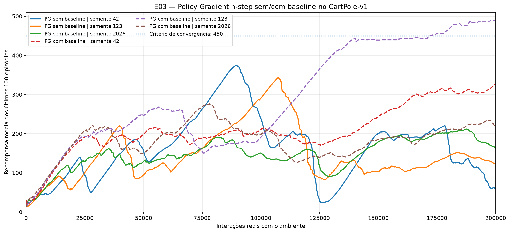
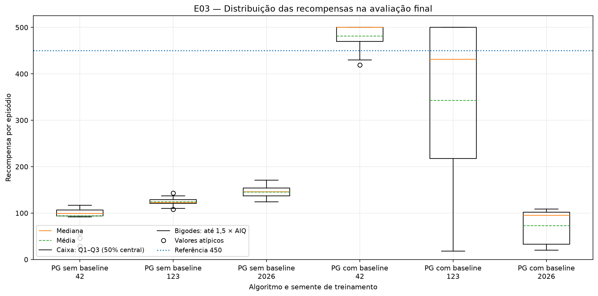
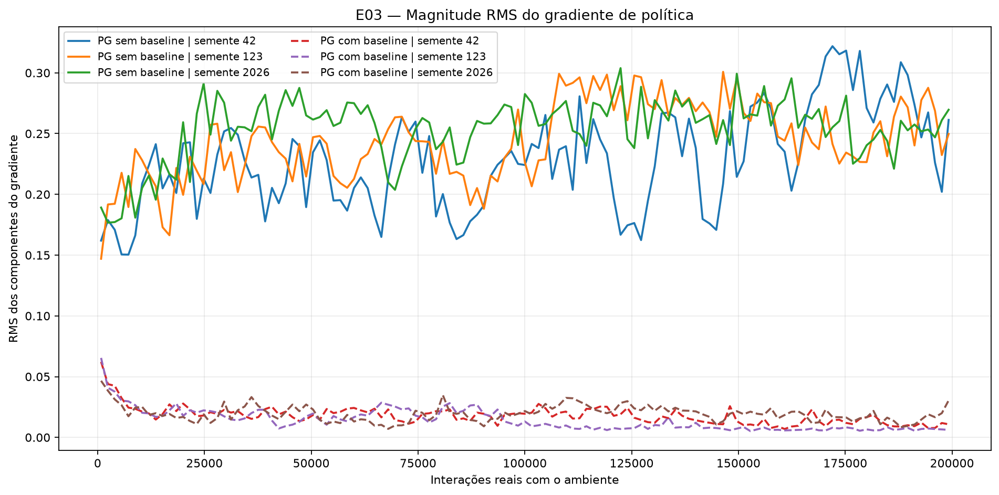
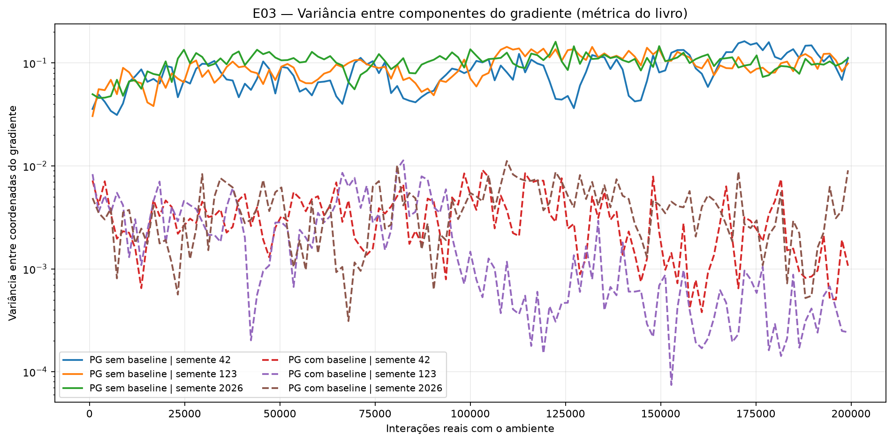
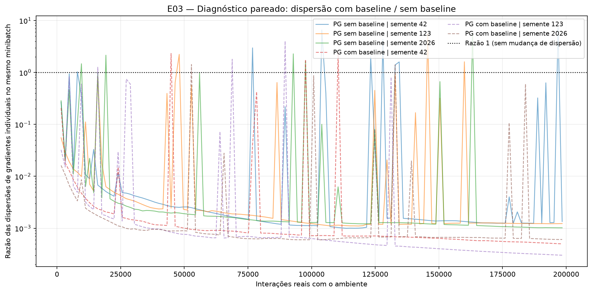
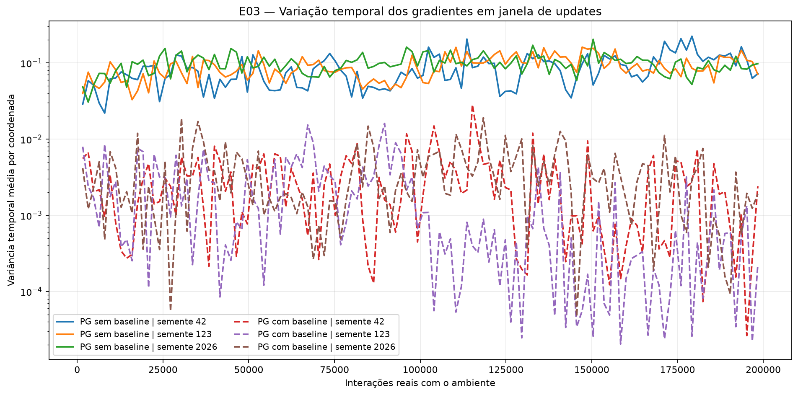
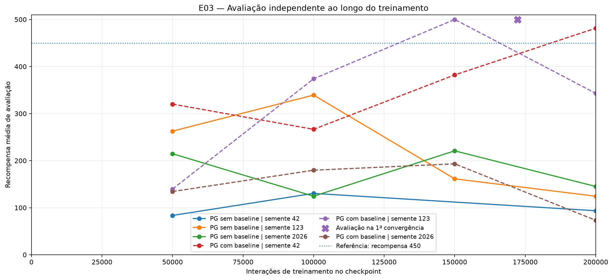
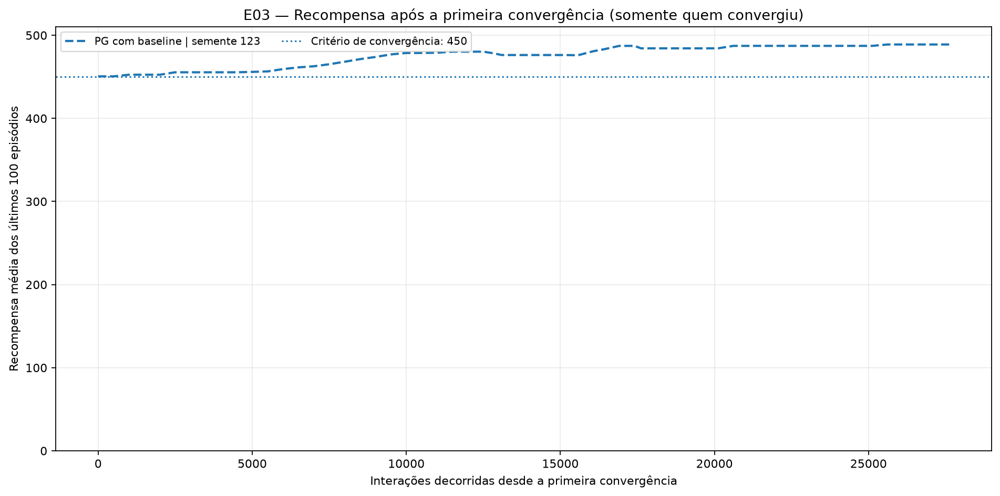

# Experimento E03 — Variabilidade dos gradientes de política com e sem baseline no CartPole-v1

**Protocolo:** 200.000 interações de treinamento por execução, sem parada antecipada por convergência  
**Data:** 22 de novembro de 2026  
**Scripts:** `e03_cartpole.py` (execução) e `analise_e03.py` (análise)

## 1. Introdução

O experimento E03 investiga o efeito de um **baseline** sobre a magnitude e a variabilidade dos gradientes de política em um método *Policy Gradient* com retornos *n-step*, utilizando o ambiente **CartPole-v1**. A implementação parte de `Chapter12/01_cartpole_pg.py`, do capítulo 12 de *Deep Reinforcement Learning Hands-On* (3ª edição), comparando uma variante sem baseline com outra que subtrai dos retornos uma média acumulada.

O E02 havia indicado maior estabilidade de desempenho no REINFORCE com baseline por episódio. Entretanto, curvas de recompensa não medem diretamente a variabilidade dos gradientes. O E03 aprofunda essa investigação por meio do registro dos gradientes durante o treinamento e de um diagnóstico pareado, que calcula escalamentos com e sem baseline **sobre os mesmos minibatches e com os mesmos parâmetros da rede**.

Os objetivos são **(i)** comparar a magnitude e a dispersão dos gradientes, **(ii)** verificar a evolução do desempenho das políticas, **(iii)** confrontar as avaliações independentes com o histórico de treinamento e **(iv)** distinguir redução da variabilidade numérica dos gradientes de melhoria efetiva do aprendizado. A hipótese exploratória é que a subtração de um baseline diminua a dispersão das contribuições ao gradiente, embora isso não garanta convergência ou estabilidade da política.

## 2. Fundamentação teórica

Nos métodos de **gradiente de política**, uma rede com parâmetros \(\theta\) define a distribuição \(\pi_\theta(a\mid s)\). As atualizações procuram aumentar a probabilidade das ações associadas a retornos favoráveis, utilizando contribuições proporcionais a \(G_t\nabla_\theta\log\pi_\theta(a_t\mid s_t)\). No caso de retornos *n-step*, o alvo incorpora uma soma descontada de recompensas por um número limitado de transições e, quando aplicável, o valor residual definido pela implementação do método.

Na versão sem baseline, a perda de política pode ser representada por:

\[
L_{\mathrm{PG}}(\theta)=-\frac{1}{B}\sum_{i=1}^{B}G_i^{(n)}\log\pi_\theta(a_i\mid s_i).
\]

Na versão com baseline, o retorno é substituído por \(G_i^{(n)}-b_i\):

\[
L_{\mathrm{PG+baseline}}(\theta)=-\frac{1}{B}\sum_{i=1}^{B}\bigl(G_i^{(n)}-b_i\bigr)\log\pi_\theta(a_i\mid s_i).
\]

O baseline específico do exemplo do capítulo 12 é a **média acumulada dos retornos *n-step* observados até a experiência corrente**, incluindo-a no cálculo. Portanto, **não é um crítico aprendido \(V(s)\)** e **não é a média dos retornos de cada episódio empregada no E02**. O procedimento altera os pesos usados nas contribuições ao gradiente; valores próximos da média acumulada passam a produzir sinais residuais pequenos.

Para não confundir grandezas distintas, foram examinadas três famílias de métricas:

1. **Magnitude e dispersão entre componentes:** RMS do vetor de gradiente da perda de política e variância entre as coordenadas desse vetor em uma atualização. A segunda corresponde à métrica `grad_var` utilizada no exemplo do livro, **não** à variância estatística de estimadores produzidos por amostragens independentes.
2. **Variação temporal:** variância dos vetores de gradiente de atualizações consecutivas em uma janela. Como os parâmetros e a distribuição de experiências mudam durante o treinamento, a medida reúne variação estocástica e evolução do próprio processo de aprendizado.
3. **Diagnóstico pareado:** dispersão entre contribuições individuais ao gradiente de um mesmo minibatch, calculadas contrafactualmente com retornos brutos ou retornos centralizados, sempre com os mesmos pesos da rede e os mesmos dados. Esse diagnóstico isola melhor o efeito imediato do escalamento, mas as transições *n-step* consecutivas são correlacionadas; não se trata de uma estimativa IID da variância do estimador de política.

A menor variância numérica pode decorrer tanto da redução da variabilidade das contribuições quanto da **diminuição de sua escala**. Por isso, magnitude dos gradientes e qualidade da política são analisadas em conjunto.

## 3. Metodologia experimental

O ambiente **CartPole-v1** apresenta quatro variáveis contínuas de observação, duas ações discretas e recompensa **+1 por passo**, com máximo de **500 pontos por episódio**.

Foram realizadas **seis execuções**, correspondentes às variantes **PG sem baseline** e **PG com baseline**, cada uma com sementes **42, 123 e 2026**. Todas foram treinadas por **200.000 interações reais com o ambiente**, utilizando `--no-stop-on-convergence`. A primeira convergência foi definida como a primeira média móvel de **100 episódios completos de treinamento** igual ou superior a **450**, depois de acumulados pelo menos 100 episódios. Esse marco não interrompeu as atualizações.

Foram programadas avaliações independentes nos marcos de **50.000, 100.000, 150.000 e 200.000 passos**, além da primeira convergência, quando atingida. Cada checkpoint foi avaliado por **20 episódios**, com pesos congelados, política estocástica e sementes de avaliação comuns (**100000 a 100019**). As interações de avaliação não entraram no orçamento de treinamento.

As duas variantes utilizaram a mesma arquitetura de rede de política (`PGN`) e os hiperparâmetros do exemplo original:

| Configuração | PG sem baseline | PG com baseline |
|---|---|---|
| Fator de desconto \(\gamma\) | 0,99 | 0,99 |
| Taxa de aprendizado | 0,001 | 0,001 |
| Otimizador | Adam | Adam |
| Tamanho de minibatch | 8 experiências | 8 experiências |
| Retorno *n-step* (`REWARD_STEPS`) | 10 | 10 |
| Coeficiente de entropia | 0,01 | 0,01 |
| Sinal de atualização | Retorno *n-step* | Retorno *n-step* menos média acumulada |
| Seleção de ações | Estocástica | Estocástica |
| Orçamento | 200.000 interações | 200.000 interações |

Cada execução realizou **24.998 atualizações de gradiente**. Para os diagnósticos pareados, foram registradas **124 medições por execução** (uma a cada 200 atualizações), totalizando **744 diagnósticos**. Os resultados foram organizados em `results/e03/completo/no_stop_on_convergence/` e analisados em `analises/e03/steps_200000/no_stop_on_convergence/`.

**Observação sobre a coleta:** o checkpoint periódico de **150.000 passos** da execução **PG sem baseline, semente 42**, não consta dos dados. Nessa versão do executor, a captura periódica dependia da coincidência exata com o marco de interações, que podia ser ultrapassado durante a coleta de experiências pelo PTAN. Esse ponto está ausente do Gráfico 07; **não** deve ser interpretado como uma medição realizada. As demais avaliações e a avaliação final dessa execução estão presentes.

## 4. Resultados

### 4.1. Aprendizado e avaliação final

Todas as seis execuções consumiram o orçamento de 200.000 interações. **Nenhuma** das três execuções sem baseline atingiu o limiar de convergência. Com baseline, **uma das três** convergiu: a semente **123**, após **172.256 interações**, com média móvel de **450,59** no instante do primeiro cruzamento.

| Variante | Semente | Primeira convergência (interações) | Média móvel final do treino | Avaliação final: média ± DP (20 episódios) | Avaliações finais ≥ 450 |
|---|---:|---:|---:|---:|---:|
| Sem baseline | 42 | — | 60,42 | 93,55 ± 22,81 | 0/20 |
| Sem baseline | 123 | — | 123,03 | 124,45 ± 8,74 | 0/20 |
| Sem baseline | 2026 | — | 162,73 | 145,15 ± 12,76 | 0/20 |
| Com baseline | 42 | — | 326,62 | 481,50 ± 27,14 | 16/20 |
| Com baseline | 123 | 172.256 | 488,93 | 342,95 ± 183,63 | 10/20 |
| Com baseline | 2026 | — | 216,55 | 73,20 ± 34,66 | 0/20 |

A média das recompensas médias por semente na avaliação final foi **121,05** sem baseline e **299,22** com baseline, diferença de **178,17 pontos**. Entretanto, o desvio-padrão **entre as três médias por semente** aumentou de **25,97** para **207,63**. Portanto, a melhora da média agregada com baseline não representa desempenho consistente: uma execução teve avaliação elevada, outra apresentou grande dispersão entre episódios, e a terceira terminou com desempenho baixo.

A **semente 42 com baseline** alcançou avaliação final média de **481,50**, embora nunca tenha atingido média móvel de 450 nos 100 últimos episódios de **treinamento**. Já a **semente 123 com baseline** atingiu média móvel final de **488,93**, mas foi avaliada em apenas **342,95**, com desvio-padrão de **183,63**. Não há contradição entre os resultados: são medições diferentes, coletadas sob trajetórias e protocolos distintos.

### 4.2. Curvas de aprendizado — Gráfico 01

O **Gráfico 01** mostra forte oscilação do PG sem baseline nas sementes **42** e **123**, inclusive perdas substanciais após períodos de melhora. Na semente 42, a média móvel chegou a aproximadamente **373,99** e depois recuou expressivamente; a semente 123 alcançou **343,90** antes de apresentar queda. A semente 2026 permaneceu em patamares inferiores, sem alcançar o limiar de 450.

Com baseline, as trajetórias foram diferentes entre si. A semente **123** foi a única a ultrapassar a referência de convergência, em torno de 172 mil passos; a semente **42** progrediu até cerca de 327 pontos de média móvel ao final; e a **2026** não sustentou os ganhos iniciais. A variante com baseline apresentou, portanto, **maior potencial de desempenho em algumas sementes**, mas não uma trajetória de aprendizado uniformemente superior.

### 4.3. Distribuição das avaliações finais — Gráfico 02

O **Gráfico 02** confirma a dispersão dos resultados com baseline. A semente 42 obteve recompensas concentradas próximas ao máximo de 500; a semente 123 apresentou episódios variando de valores muito baixos até 500; e a semente 2026 concentrou resultados em valores baixos. Sem baseline, as três distribuições finais permaneceram abaixo do patamar de 450.

A maior dispersão entre sementes com baseline revela que a redução dos gradientes não implicou confiabilidade uniforme do treinamento. Também é importante observar que a recompensa tem **teto em 500**, o que comprime a dispersão visível das políticas que atingem a pontuação máxima com frequência.

### 4.4. Magnitude dos gradientes — Gráfico 03

O **Gráfico 03** apresenta uma diferença persistente de escala entre as variantes. Considerando as médias das três sementes, o RMS do gradiente foi aproximadamente **0,2421** sem baseline e **0,01723** com baseline: uma redução de cerca de **14,1 vezes**. As execuções com baseline também apresentaram gradientes de menor magnitude máxima observada.

| Semente | RMS médio sem baseline | RMS médio com baseline | Variância média entre componentes sem baseline | Variância média entre componentes com baseline |
|---:|---:|---:|---:|---:|
| 42 | 0,22826 | 0,01799 | 0,08457 | 0,00327 |
| 123 | 0,24425 | 0,01410 | 0,09294 | 0,00215 |
| 2026 | 0,25390 | 0,01959 | 0,10153 | 0,00397 |

A redução de magnitude é um resultado importante por si só: o sinal residual empregado na atualização da política é muito menor quando o retorno fica próximo da média acumulada.

### 4.5. Variância entre componentes — Gráfico 04

O **Gráfico 04**, em escala logarítmica, mostra que a variância **entre coordenadas do gradiente** ficou em níveis muito menores com baseline. As médias agregadas foram **0,09302** sem baseline e **0,00313** com baseline: redução de aproximadamente **29,7 vezes**.

Esse resultado reproduz, para as condições testadas, o comportamento esperado da métrica utilizada no material do capítulo 12. Contudo, o valor **não pode ser apresentado isoladamente como prova de redução da variância de amostragem do estimador de gradiente**, pois uma contração da magnitude também reduz a dispersão numérica entre componentes.

### 4.6. Diagnóstico pareado sobre o mesmo minibatch — Gráfico 05

O **Gráfico 05** mostra a razão entre duas medidas contrafactuais de dispersão das contribuições individuais:

\[
R=\frac{\operatorname{Var}_{\mathrm{minibatch}}[g_i\,\vert\,\text{com baseline}]}{\operatorname{Var}_{\mathrm{minibatch}}[g_i\,\vert\,\text{sem baseline}]}.
\]

Em cada medição, os gradientes das ações foram calculados com **os mesmos parâmetros da rede e as mesmas experiências**; apenas o escalamento pelo retorno bruto ou centralizado foi alterado. Valores de \(R<1\) indicam menor dispersão das contribuições **naquele minibatch** quando se emprega baseline.

Foram coletados **744 diagnósticos pareados**. A fração de medições com razão inferior a 1 variou de **93,5% a 98,4%** entre as seis execuções. As razões medianas por execução foram da ordem de **0,00064 a 0,00154**, embora tenham ocorrido picos isolados acima de 1. Assim, o baseline produziu dispersão menor na grande maioria dos minibatches observados, mas **não em todos eles**.

A comparação pareada é mais informativa do que confrontar apenas dois treinamentos independentes, pois controla os dados e os pesos da rede no momento de cada diagnóstico. Ainda assim, a dependência temporal entre experiências consecutivas e a mudança da política ao longo do treinamento limitam interpretações estatísticas mais fortes.

### 4.7. Variação temporal dos gradientes — Gráfico 06

O **Gráfico 06** indica menor dispersão temporal dos vetores de gradiente com baseline. A média dessa métrica foi aproximadamente **0,09121** sem baseline e **0,00303** com baseline — redução de cerca de **30,1 vezes**.

Essa medida descreve como o gradiente muda entre atualizações de uma política **que também está sendo modificada**. Portanto, reúne flutuações estocásticas e alterações sistemáticas induzidas pelo treinamento; não equivale a repetir a estimativa do gradiente sob uma política fixa.

### 4.8. Avaliações independentes dos checkpoints — Gráfico 07

O **Gráfico 07** evidencia que a menor magnitude dos gradientes com baseline não se traduziu automaticamente em estabilidade de recompensa. A variante sem baseline terminou com avaliações baixas nas três sementes; com baseline, a semente 42 melhorou ao longo do treinamento, a semente 123 chegou a **500** pontos na avaliação de **150.000 passos** e na primeira convergência, mas recuou na avaliação final, enquanto a semente 2026 permaneceu abaixo de 200 nos checkpoints periódicos e terminou em **73,20**.

A avaliação de **500 pontos aos 150.000 passos** na semente 123 com baseline ocorreu **antes** da primeira convergência segundo o critério de treinamento (**172.256 passos**). Isso reforça que a recompensa de avaliação em 20 episódios e a média móvel dos últimos 100 episódios de treino representam indicadores diferentes. O gráfico não contém a avaliação periódica de 150.000 passos da semente 42 sem baseline, conforme a ressalva metodológica da seção 3.

### 4.9. Comportamento após a primeira convergência — Gráfico 08

O **Gráfico 08** contém somente a execução **PG com baseline, semente 123**, pois foi a única que alcançou a média móvel de 450. Depois da primeira convergência, essa média móvel **permaneceu acima de 450 e aumentou**, chegando a **488,93** ao final.

Em contraste, a avaliação independente no checkpoint da primeira convergência foi **500,00**, enquanto a avaliação final recuou para **342,95**. Portanto, a manutenção da média móvel de treino acima do limiar **não garante** que a política produzirá resultados homogêneos nos episódios de avaliação.

## 5. Discussão

**A evidência de redução numérica dos gradientes é consistente.** O RMS médio caiu cerca de **14,1 vezes** com baseline; a variância entre componentes, **29,7 vezes**; e a variação temporal, **30,1 vezes**. O diagnóstico pareado, que reutiliza pesos e experiências idênticos, também mostrou menor dispersão das contribuições individuais na grande maioria dos minibatches. Esses resultados são coerentes com o efeito da centralização sobre o sinal de atualização.

**A escala do gradiente é parte essencial da interpretação.** No CartPole, a recompensa por passo é constante e positiva, e os retornos *n-step* podem assumir valores próximos em muitas transições. Nos registros da variante com baseline, o retorno médio por minibatch foi aproximadamente **9,36**, contra baseline médio de **9,26**, deixando sinal residual médio próximo de **0,096**. A contração dos gradientes pode, assim, refletir tanto menor dispersão das contribuições quanto atualizações mais fracas. Não se deve interpretar a razão de variâncias de forma independente da magnitude.

**Reduzir os gradientes não assegurou convergência consistente.** Com baseline, somente **1/3** das sementes atingiu o limiar de treino, apesar do desempenho final médio superior (**299,22 contra 121,05**). A dispersão entre as médias finais por semente foi também muito maior com baseline (**207,63 contra 25,97**). Uma das execuções com baseline terminou com avaliação inferior à obtida por todas as sementes sem baseline. Portanto, não há suporte para afirmar que essa variante resolveu de forma robusta o CartPole nas condições testadas.

**A comparação com o E02 exige cautela.** No E02, o REINFORCE utilizava retornos de episódios completos e um baseline calculado dentro de cada episódio. O E03 emprega retornos *n-step*, média acumulada e hiperparâmetros próprios do exemplo do capítulo 12. Assim, os resultados comportamentais de E02 e E03 não isolam uma única mudança; a conclusão direta do E03 é restrita à comparação **com versus sem baseline dentro do protocolo do próprio E03**.

**Convergência no treino e desempenho independente não são equivalentes.** A semente 123 com baseline ilustra esse ponto: a média móvel permaneceu elevada após atingir 450, mas a avaliação independente final exibiu grande variação entre episódios. Da mesma forma, a semente 42 com baseline obteve avaliação final elevada sem atingir o limiar de treino. O uso combinado dos dois indicadores evita considerar um único gráfico como descrição completa da qualidade da política.

**Limitações.** O experimento utiliza **três sementes por variante**, um único ambiente e hiperparâmetros fixos, sem teste formal de significância entre treinamentos independentes. As avaliações possuem 20 episódios com sementes repetidas entre checkpoints. As métricas de gradiente são sensíveis à escala e não identificam isoladamente a variância de um estimador sob amostragens IID. O baseline inclui a amostra corrente e não foi analisado quanto a possíveis efeitos de viés. Houve ainda a ausência de um checkpoint intermediário na execução PG sem baseline, semente 42, sem afetar sua avaliação final ou os registros dos gradientes. Esses pontos restringem a generalização das conclusões.

## 6. Conclusões

O E03 comparou **Policy Gradient *n-step* sem e com baseline** no CartPole-v1, com **200.000 interações de treinamento por semente**, três sementes por variante e acompanhamento dos gradientes e das políticas em checkpoints independentes.

O baseline acumulado dos retornos *n-step* esteve associado a **redução substancial da magnitude e da dispersão observada dos gradientes**: aproximadamente **14,1 vezes** no RMS, **29,7 vezes** na variância entre componentes e **30,1 vezes** na variação temporal. O diagnóstico pareado confirmou menor dispersão das contribuições individuais em quase todas as medições.

Entretanto, o ganho nas métricas de gradiente **não produziu convergência robusta**: nenhuma das três execuções sem baseline convergiu, e apenas **uma das três com baseline** atingiu o critério de média móvel ≥ 450. Embora a avaliação final média tenha sido maior com baseline (**299,22 contra 121,05**), os resultados foram muito heterogêneos entre sementes, e uma política que preservou alta recompensa média durante o treino não manteve desempenho igualmente uniforme em avaliação independente.

A conclusão central é que **diminuir a magnitude e a dispersão dos gradientes não é condição suficiente para obter uma política estável e de alto desempenho**. As evidências apoiam o efeito do baseline sobre os sinais de atualização, mas não permitem atribuir toda a redução à eliminação de ruído estatístico nem extrapolar que o mesmo mecanismo melhore todas as execuções ou outros ambientes.

---

**Fonte dos dados:** `resumo_execucoes.csv`, `resumo_algoritmos.csv`, `resumo_gradientes.csv`, `gradientes_treinamento.csv`, `gradientes_diagnosticos.csv`, `resumo_checkpoints.csv`, `avaliacoes_checkpoints.csv`, `episodios_treinamento.csv`, `episodios_avaliacao.csv`, `resumo_analise.json` e oito gráficos da execução sem parada por convergência. As referências de imagem são relativas; o `.md` deve ficar no mesmo diretório dos arquivos `.png` gerados por `analise_e03.py`.
