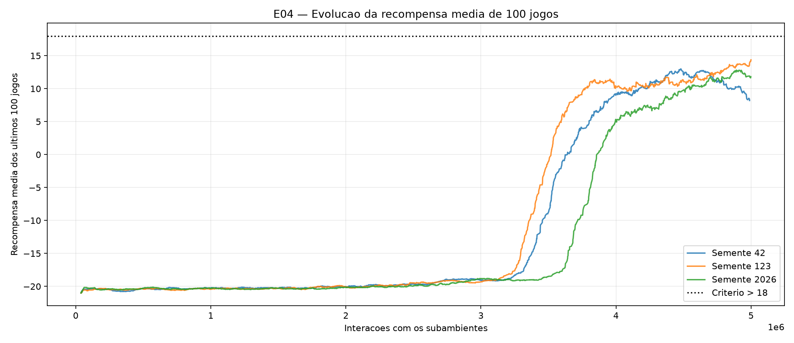
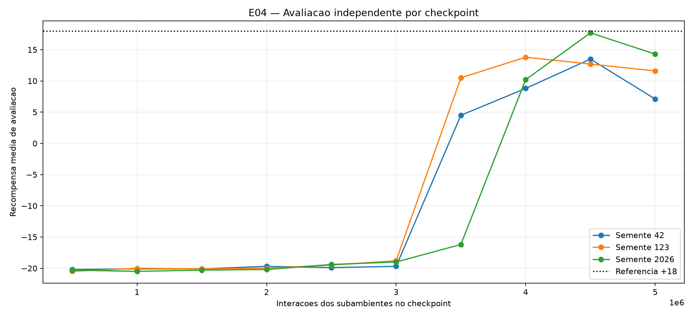
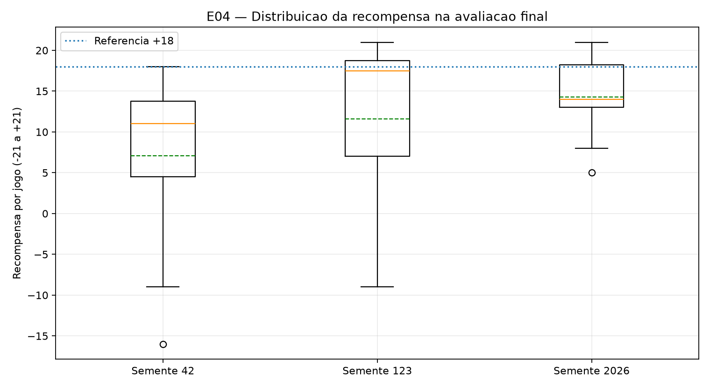
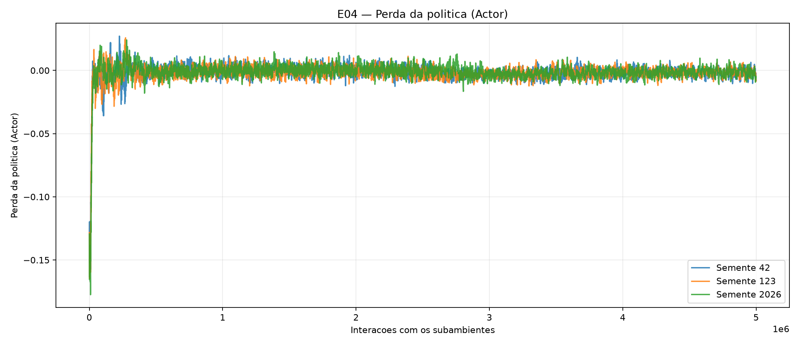
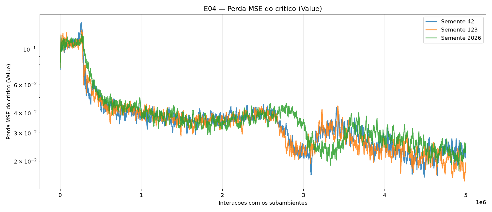
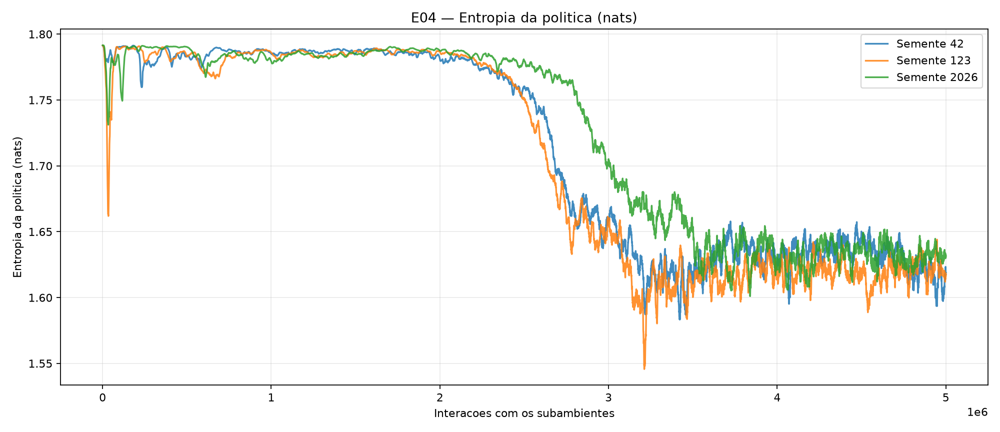
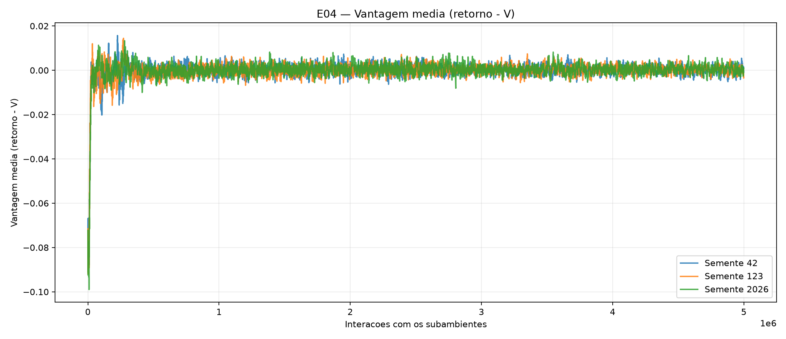
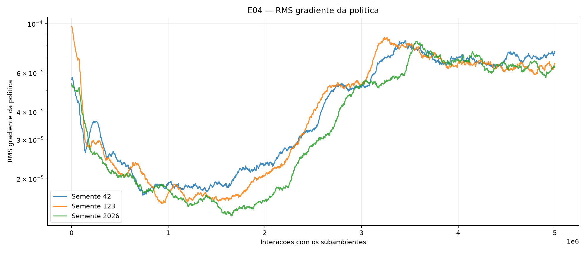
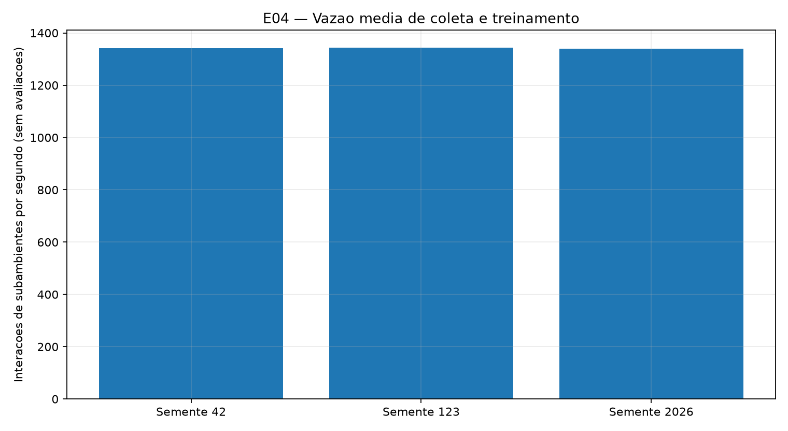

# Experimento E04 — Aprendizado por A2C no Pong

## 1. Introdução

Este experimento investiga o aprendizado do algoritmo **Advantage Actor-Critic (A2C)** no ambiente **PongNoFrameskip-v4**, utilizando a implementação do Capítulo 12 de *Deep Reinforcement Learning Hands-On*. Diferentemente dos experimentos anteriores com CartPole, o Pong exige que a política seja aprendida a partir de observações visuais, com recompensas por partida entre **−21 e +21**.

O objetivo é caracterizar a evolução do desempenho do A2C, o número de interações necessário para observar aprendizado, a variabilidade entre sementes e o comportamento de indicadores internos — perda do ator, erro do crítico, entropia, vantagem e gradientes. Foram realizadas três execuções independentes, todas com orçamento fixo de **5.000.000 de interações**, sem interrupção antecipada por convergência.

## 2. Fundamentação teórica

O A2C combina dois componentes em uma rede com representação compartilhada: o **ator**, que produz uma distribuição de probabilidades sobre as ações, e o **crítico**, que estima o valor do estado. O ator é atualizado usando uma estimativa de vantagem, calculada pela diferença entre um retorno com *bootstrap* e a estimativa do crítico:

\[
A_t \approx R_t^{(n)} - V(s_t).
\]

Na implementação utilizada, o retorno é calculado em **4 passos** (*n-step*), e o crítico é treinado pela perda quadrática entre seu valor previsto e o retorno-alvo. Um termo de entropia incentiva a exploração, enquanto o *clipping* da norma do gradiente limita atualizações muito intensas. A métrica de perda do ator não deve ser interpretada como uma medida direta da qualidade da política: por ser ponderada por vantagens com sinais distintos, seu valor agregado pode permanecer próximo de zero durante o aprendizado.

A **entropia** descreve a dispersão da distribuição de ações. Com seis ações equiprováveis, seu valor máximo é \(\ln 6 \approx 1{,}792\) nats. Sua redução indica maior concentração de probabilidades, mas não comprova, isoladamente, melhora da política.

## 3. Metodologia experimental

O experimento foi conduzido com o código `e04_pong.py`, adaptado de `Chapter12/02_pong_a2c.py`, preservando a arquitetura e os hiperparâmetros principais do exemplo. A coleta de experiências utilizou **50 ambientes vetorizados síncronos** (`SyncVectorEnv`), com observações pré-processadas de dimensão **(4, 84, 84)** e **6 ações** disponíveis. Os treinamentos foram executados na GPU **MPS de um Apple M2 Max**.

| Parâmetro | Configuração |
|---|---|
| Algoritmo | A2C (*Advantage Actor-Critic*) |
| Ambiente | `PongNoFrameskip-v4` |
| Sementes de treinamento | 42, 123 e 2026 |
| Interações por semente | 5.000.000 |
| Ambientes síncronos | 50 |
| Retorno | *n-step*, com 4 passos |
| Parada antecipada | Desabilitada (`--no-stop-on-convergence`) |
| Convergência monitorada | Média dos últimos 100 jogos completos **> +18** |
| Checkpoints e avaliações | A cada 500.000 interações e no final |
| Avaliação independente | 10 jogos por checkpoint, com política estocástica e sementes de avaliação fixas |
| Dispositivo | `mps` |

**Unidades de contagem.** Cada interação corresponde a uma chamada `env.step` de um subambiente já encapsulado pelos *wrappers* Atari. Assim, 5 milhões de interações equivalem a **100.000 passos vetorizados** com 50 ambientes, mas **não** a 5 milhões de quadros brutos do emulador ALE, pois os *wrappers* aplicam *frameskip*. O treinamento prosseguiu até consumir o orçamento mesmo sem alcançar o limiar de convergência.

**Ajuste técnico documentado.** Foi corrigido o *broadcasting* inadvertido da vantagem do exemplo original, reduzindo a saída do crítico de formato `[batch, 1]` para `[batch]` com `squeeze(-1)`. Essa correção preserva o cálculo pretendido da vantagem por amostra; o código original do livro não foi alterado.

Foram coletadas recompensas por jogo, médias móveis, perdas dos componentes, entropia, vantagem, métricas dos gradientes, checkpoints e avaliações independentes. Os tempos de treinamento apresentados **excluem o tempo das avaliações**. O desenho utiliza três sementes para caracterização exploratória, sem testes de significância estatística.

## 4. Resultados

### 4.1. Síntese das execuções

| Semente | Jogos concluídos | Atualizações | Média móvel final (100 jogos) | Avaliação final (média ± DP) | Convergiu? |
|---|---:|---:|---:|---:|---|
| 42 | 3.621 | 39.060 | +8,20 | +7,10 ± 11,28 | Não |
| 123 | 3.595 | 39.060 | +14,37 | +11,60 ± 10,44 | Não |
| 2026 | 3.799 | 39.060 | +11,82 | +14,30 ± 5,08 | Não |

A média das três médias de avaliação final foi **+11,00**, com desvio-padrão **3,64 entre sementes**. Esse desvio-padrão não deve ser confundido com a variação entre as dez partidas de cada avaliação, indicada individualmente na tabela. Nenhuma execução atingiu a média móvel de treinamento superior a **+18**, embora as políticas tenham vencido partidas individuais.

### 4.2. Evolução das recompensas durante o treinamento — Gráfico 01

O **Gráfico 01** evidencia uma evolução em fases. Nas três sementes, a recompensa permaneceu próxima de **−20** até aproximadamente **3,2–3,4 milhões** de interações. Em seguida, houve um aumento expressivo, com a transição ocorrendo primeiro na semente **123**, depois na **42** e por último na **2026**. A diferença temporal é relevante: embora as curvas tenham formatos semelhantes, o momento de aceleração não foi idêntico.

A primeira ocorrência de média móvel **positiva** foi registrada em aproximadamente **3.519.050** interações (semente 123), **3.639.600** (42) e **3.859.050** (2026). A maior média móvel observada em cada execução foi **+13,01** aos **4.479.950** passos (42), **+14,37** próximo ao encerramento (123) e **+12,81** aos **4.891.400** passos (2026).

A semente 42 terminou com desempenho inferior ao seu próprio pico; na semente 123 a curva ainda melhorava no fim do orçamento, e a 2026 apresentou uma pequena redução após seu pico.

### 4.3. Avaliações independentes ao longo dos checkpoints — Gráfico 02

O **Gráfico 02** confirma que o aumento observado durante o treinamento também ocorreu em avaliações independentes. Até 3 milhões de interações, as três políticas continuavam próximas de **−20**. Depois, os resultados passaram a divergir de acordo com o momento de aprendizado de cada semente.

| Checkpoint (milhões de interações) | Semente 42 | Semente 123 | Semente 2026 |
|---:|---:|---:|---:|
| 3,0 | −19,70 | −18,80 | −19,00 |
| 3,5 | +4,50 | +10,50 | −16,20 |
| 4,0 | +8,80 | +13,80 | +10,20 |
| 4,5 | **+13,50** | +12,70 | **+17,70** |
| 5,0 | +7,10 | +11,60 | +14,30 |

O melhor checkpoint **observado** foi o de 4,5 milhões para as sementes 42 e 2026, e o de 4 milhões para a semente 123. Portanto, em todas as execuções, a avaliação final foi inferior à melhor avaliação intermediária registrada. Como cada checkpoint foi avaliado com apenas dez partidas, essa ordenação é descritiva e não comprova superioridade estatística entre checkpoints.

### 4.4. Distribuição das recompensas finais — Gráfico 03

O **Gráfico 03** mostra diferenças importantes de dispersão. Na semente 42, as recompensas finais variaram de **−16 a +18**, com média **+7,10** e mediana **+11**. A semente 123 variou de **−9 a +21**, com média **+11,60** e mediana **+17,5**. A semente 2026 variou de **+5 a +21**, com média **+14,30** e mediana **+14**; todas as suas dez partidas tiveram recompensa positiva.

Esses dados indicam que a política final da semente 2026 foi a mais consistente na pequena amostra de avaliação final. Entretanto, **dez partidas por semente** são insuficientes para caracterizar com precisão a variabilidade de desempenho esperado.

### 4.5. Perda do ator — Gráfico 04

O **Gráfico 04** apresenta oscilações mais acentuadas no começo das execuções, seguidas por perdas da política próximas de zero durante grande parte do treinamento. Isso não implica ausência de aprendizado: contribuições positivas e negativas, ponderadas pela vantagem, podem se compensar no valor médio da função de perda.

### 4.6. Perda do crítico — Gráfico 05

O **Gráfico 05** mostra queda acentuada do erro quadrático do crítico na fase inicial e valores geralmente menores no fim do treinamento. Nas três sementes, a média da perda do crítico nos primeiros 2 milhões de passos foi aproximadamente **0,051**, enquanto no trecho a partir de 4 milhões ficou entre **0,022 e 0,025**. Isso representa redução do erro em relação aos alvos de treinamento; não constitui, isoladamente, medida de exatidão do valor real dos estados.

### 4.7. Entropia da política — Gráfico 06

O **Gráfico 06** mostra a entropia próxima de **1,79 nats** durante a fase de baixo desempenho, com redução mais pronunciada entre cerca de **2,5 e 3,6 milhões** de interações. A entropia passou a oscilar tipicamente em torno de **1,60–1,65 nats**, sinalizando maior concentração da distribuição de ações. A mudança antecedeu ou acompanhou o salto de recompensa, mas os dados observacionais não estabelecem relação causal.

### 4.8. Vantagem média — Gráfico 07

O **Gráfico 07** registra uma fase inicial com vantagem média predominantemente negativa e um regime posterior de oscilações pequenas ao redor de zero. Como a métrica agrega amostras com sinais diferentes, uma média próxima de zero não elimina a presença de vantagens individuais informativas nem permite, sozinha, avaliar a qualidade do crítico.

### 4.9. Magnitude do gradiente da política — Gráfico 08

No **Gráfico 08**, a magnitude RMS do gradiente da política diminui durante a fase inicial, mas volta a crescer aproximadamente a partir de 2 milhões de interações, acompanhando a transição para políticas com maior recompensa. A métrica foi coletada para a parcela da **política**, antes de agregar os termos do crítico e da entropia. A associação temporal não demonstra que o crescimento da magnitude dos gradientes tenha causado a melhora.

### 4.10. Vazão computacional — Gráfico 09

O **Gráfico 09** mostra vazão praticamente igual nas três execuções: **1.342,09**, **1.343,61** e **1.340,05 interações/s** para as sementes 42, 123 e 2026, respectivamente. A média foi **1.341,92 interações/s**. Cada execução consumiu aproximadamente **62 minutos de treinamento**, excluindo avaliações, totalizando cerca de **3 horas e 6 minutos** de treinamento nas três sementes. Não se observaram diferenças de desempenho computacional relevantes entre elas.

## 5. Discussão

**Aprendizado efetivo, porém tardio.** As três sementes reproduziram uma trajetória qualitativamente semelhante: longa fase com recompensa próxima do mínimo, seguida de melhoria acelerada. Esse padrão sustenta que o A2C implementado consegue aprender uma política funcional para o Pong, mas com custo substancial em interações. O instante da transição variou entre as sementes, o que inviabiliza estabelecer um limiar único de passos necessário para aprender.

**O melhor checkpoint não foi o final.** As três melhores avaliações independentes ocorreram antes do orçamento completo. O caso mais evidente foi a semente 42, cuja avaliação caiu de **+13,50** em 4,5 milhões para **+7,10** em 5 milhões. As sementes 123 e 2026 também apresentaram queda, de **+13,80 para +11,60** e de **+17,70 para +14,30**, respectivamente. Isso justifica armazenar e analisar checkpoints intermediários em vez de selecionar automaticamente os pesos do último passo.

**Recompensa de treinamento versus avaliação independente.** A média móvel de 100 jogos utiliza episódios coletados ao longo do treinamento; a avaliação executa a política congelada, em partidas próprias e com sementes controladas. A diferença entre esses indicadores é esperada, especialmente em uma política estocástica. O limiar de convergência definido no protocolo aplica-se **somente à média móvel de treinamento**, não à recompensa máxima de um episódio e tampouco à melhor média de avaliação.

**Indicadores internos e aprendizado.** O declínio da entropia e o aumento posterior da magnitude dos gradientes acompanharam a fase de melhora das recompensas. A redução progressiva da perda do crítico sugere melhor ajuste aos alvos de retorno. Entretanto, nenhuma dessas medidas permite atribuir causalmente o aprendizado a uma mudança isolada ou inferir que o agente esteja próximo de uma solução ótima.

**Limitações metodológicas.** O estudo utilizou apenas três sementes, dez partidas por avaliação de checkpoint, um único jogo e uma configuração fixa de hiperparâmetros. Não houve comparação com outros algoritmos nesta etapa, nem testes inferenciais para diferenças entre checkpoints. A avaliação foi estocástica; portanto, os resultados incorporam variabilidade da política e do ambiente. Além disso, os cinco milhões de interações se referem aos ambientes encapsulados pelos *wrappers*, e não aos quadros brutos do ALE. Os resultados descrevem **esta implementação e este orçamento**, sem demonstrar convergência universal ou estabilidade de longo prazo.

## 6. Conclusões

O experimento E04 demonstrou que o A2C aprendeu políticas capazes de obter recompensas positivas e vencer partidas no Pong, em todas as três sementes, após aproximadamente **3,3–4,0 milhões de interações**. A recompensa média final das avaliações foi **+11,00**, com diferenças entre sementes e dispersão considerável dentro das partidas avaliadas.

**Nenhuma execução alcançou o critério de convergência de média móvel superior a +18**, embora o melhor checkpoint de avaliação tenha atingido **+17,70** na semente 2026. O desempenho não evoluiu de maneira monotônica: as melhores avaliações ocorreram antes do final do orçamento, justificando a preservação dos checkpoints.

A análise conjunta das recompensas, da entropia, das perdas e dos gradientes caracterizou a transição de uma política inicialmente pouco eficaz para uma política que disputa e vence partidas, sem permitir inferências causais definitivas. Com três sementes concluídas, o E04 estabelece uma referência experimental para as comparações com **Policy Gradient (E05)**, **A2C com coleta assíncrona (E06)** e **A3C (E07)**.
