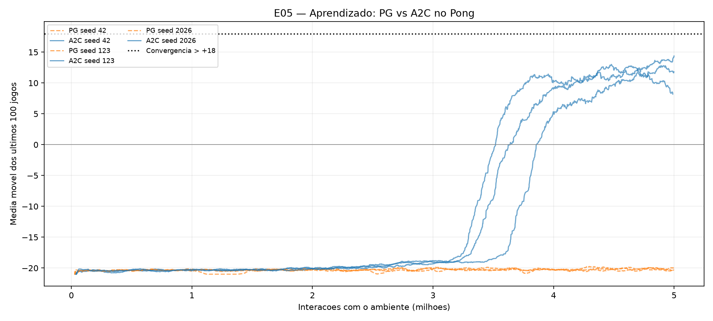
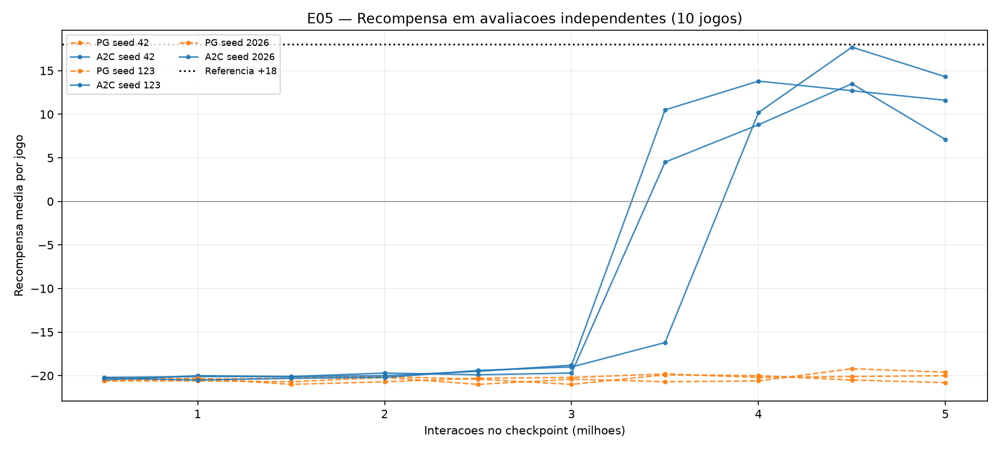
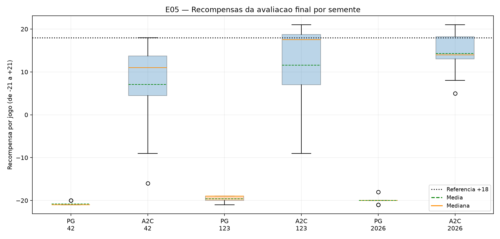
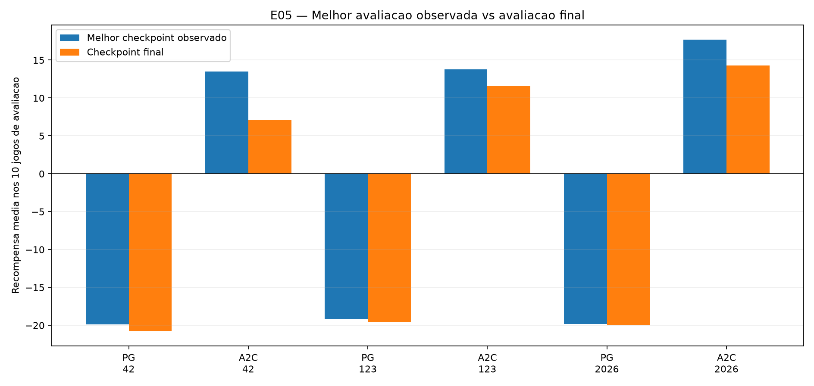
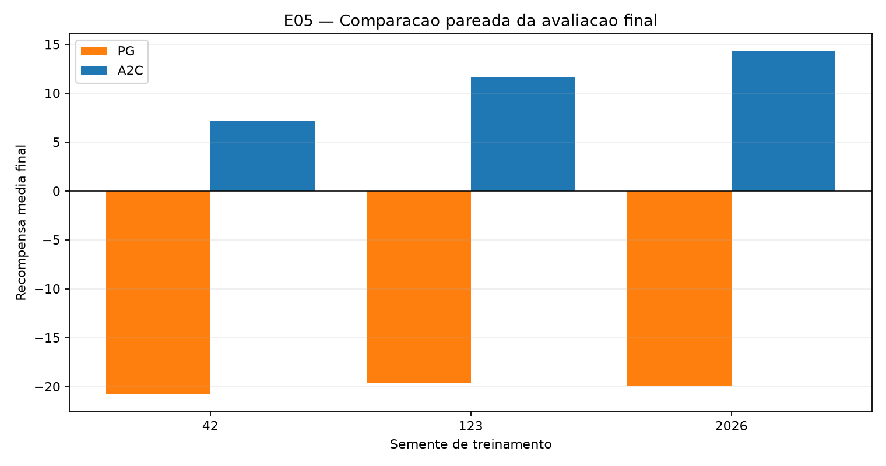
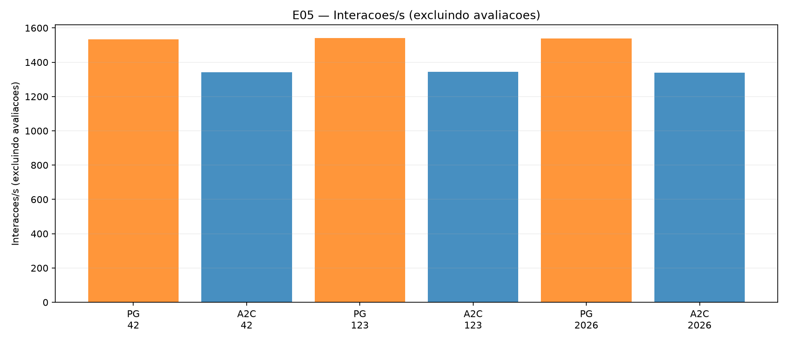
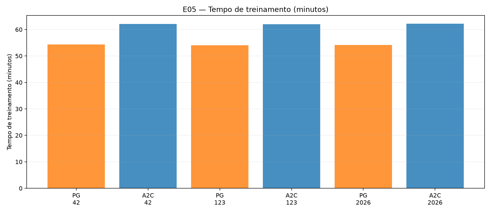
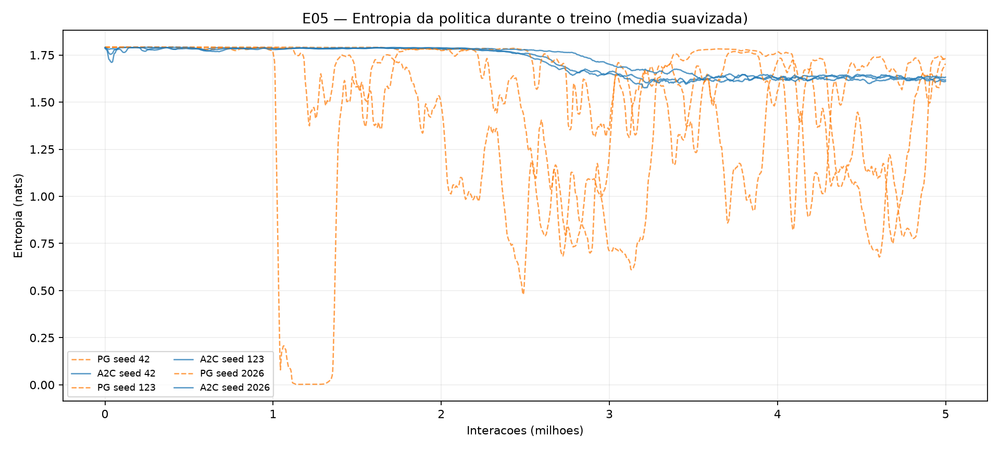

# Experimento E05 — Policy Gradient versus A2C no Pong

## 1. Introdução

O experimento E05 compara duas abordagens de aprendizado por reforço baseadas em gradientes de política no ambiente **`PongNoFrameskip-v4`**: o **Policy Gradient (PG)** do Capítulo 11 e o **Advantage Actor-Critic (A2C)** do Capítulo 12 de *Deep Reinforcement Learning Hands-On*. A questão experimental é se, sob um mesmo orçamento de interações com o ambiente, as configurações dos dois métodos apresentam diferenças de aprendizado, estabilidade, desempenho final e custo computacional.

O Pong exige decisões a partir de imagens e atribui recompensas por jogo entre **−21 e +21**. Diferentemente do CartPole, aprender uma política efetiva demanda um volume maior de experiências. Adotou-se um orçamento de **5.000.000 de interações por execução**, sem parada antecipada, e utilizaram-se as sementes **42, 123 e 2026**.

O A2C foi treinado anteriormente no E04 e seus resultados foram **reutilizados sem repetir os treinamentos**. Para o E05 foram executados três treinamentos do PG, com o mesmo orçamento e protocolo de avaliação. O propósito é comparar as **configurações completas apresentadas no livro**, e não isolar experimentalmente apenas a contribuição do crítico.

## 2. Fundamentação teórica

### 2.1. Policy Gradient (PG)

Métodos de gradiente de política parametrizam diretamente uma distribuição de ações \(\pi_\theta(a\mid s)\), ajustada para aumentar o retorno esperado. Na implementação estudada, utiliza-se uma estimativa de retorno com horizonte de **nove passos** e subtrai-se um **baseline de média móvel**, produzindo um sinal de atualização aproximadamente proporcional a:

\[
\nabla_\theta J(\theta)\approx
\mathbb{E}\!\left[(G_t-b_t)\nabla_\theta\log\pi_\theta(a_t\mid s_t)\right].
\]

O baseline busca reduzir a variabilidade do sinal de treinamento, mas não representa uma função de valor condicionada ao estado. A política do PG não dispõe de um crítico aprendido que estime explicitamente \(V(s)\).

### 2.2. Advantage Actor-Critic (A2C)

O A2C utiliza um **ator**, responsável pelas probabilidades das ações, e um **crítico**, que estima o valor esperado de cada estado. A vantagem empregada na atualização do ator é calculada pela diferença entre o retorno-alvo e a estimativa de valor:

\[
A_t\approx R_t^{(n)}-V_\phi(s_t).
\]

No exemplo utilizado, o retorno emprega **quatro passos**, com *bootstrap* pelo crítico. A rede também é otimizada para reduzir o erro quadrático de previsão de valor. As duas abordagens incluem regularização por entropia, com o objetivo de desestimular concentração prematura das probabilidades das ações.

A inclusão de um crítico pode fornecer um baseline dependente do estado, mas seu efeito não pode ser separado de outras diferenças de implementação sem um experimento de ablação específico.

## 3. Metodologia experimental

O experimento utilizou o script `e05_pong.py`, derivado de `Chapter11/05_pong_pg.py`, e os dados do E04, produzidos com `e04_pong.py`, derivado de `Chapter12/02_pong_a2c.py`. Os arquivos originais do livro foram preservados. Os treinamentos ocorreram no Apple M2 Max, utilizando **PyTorch/MPS**.

| Característica | PG (E05) | A2C (E04) |
|---|---|---|
| Código de referência | `Chapter11/05_pong_pg.py` | `Chapter12/02_pong_a2c.py` |
| Ambiente | `PongNoFrameskip-v4` | `PongNoFrameskip-v4` |
| Sementes | 42, 123, 2026 | 42, 123, 2026 |
| Interações por semente | 5.000.000 | 5.000.000 |
| Ambientes utilizados | 32, gerenciados por lista PTAN | 50, `SyncVectorEnv` |
| Horizonte de retorno | *n-step* = 9 | *n-step* = 4 |
| Baseline | Média móvel dos retornos | Crítico aprendido \(V(s)\) |
| Modelo | Rede de política | Rede com ator e crítico |
| Dispositivo | MPS | MPS |
| Parada por convergência | Desabilitada | Desabilitada |
| Avaliação por checkpoint | 10 jogos | 10 jogos |
| Intervalo entre avaliações | 500.000 interações | 500.000 interações |

**Definição do orçamento.** Uma interação corresponde a um `env.step()` de um subambiente com os *wrappers* Atari, e **não** a um quadro bruto da ALE, pois há *frameskip*. Para a semente 42 do PG foram registradas **5.000.001** interações, um passo além do limite nominal, decorrente do ponto em que o laço verifica o orçamento; a diferença é desprezível para esta comparação.

**Avaliação independente.** Em todos os checkpoints, utilizaram-se políticas **estocásticas**, dez jogos, sementes fixas de avaliação e a mesma regra de limite de passos. A condição de convergência monitorada foi a recompensa média dos **últimos 100 jogos de treinamento estritamente maior que +18**. O treinamento continuou até o orçamento, independentemente desse critério.

Foram registrados episódios e recompensas, atualizações de parâmetros, checkpoints, avaliações independentes, entropia, vazão e tempo de treinamento. O tempo contabilizado **exclui a execução das avaliações**. Os resultados constituem uma comparação exploratória com três sementes, sem pretensão de inferência estatística ampla.

## 4. Resultados

### 4.1. Resultados por execução

| Algoritmo | Semente | Jogos completos | Média móvel final (100 jogos) | Avaliação final (média ± DP) | Melhor checkpoint observado |
|---|---:|---:|---:|---:|---:|
| PG | 42 | 5.359 | −20,39 | −20,80 ± 0,42 | −19,90 (3,5 M) |
| PG | 123 | 5.544 | −20,04 | −19,60 ± 0,84 | −19,20 (4,5 M) |
| PG | 2026 | 5.397 | −20,32 | −20,00 ± 0,82 | −19,80 (3,5 M) |
| A2C | 42 | 3.621 | +8,20 | +7,10 ± 11,28 | +13,50 (4,5 M) |
| A2C | 123 | 3.595 | +14,37 | +11,60 ± 10,44 | +13,80 (4,0 M) |
| A2C | 2026 | 3.799 | +11,82 | +14,30 ± 5,08 | +17,70 (4,5 M) |

As **médias das avaliações finais entre sementes** foram **−20,13** para o PG e **+11,00** para o A2C, uma diferença de **31,13 pontos** em favor do A2C. Os desvios-padrão **entre as médias de cada semente** foram, respectivamente, **0,61** e **3,64**; não devem ser confundidos com os desvios-padrão **entre os dez jogos de avaliação** de cada execução, exibidos na tabela.

Nenhum algoritmo alcançou o critério formal de **média móvel superior a +18** nas três sementes. Contudo, o A2C apresentou média móvel **positiva** em todas elas, enquanto o PG não obteve média móvel não negativa em nenhuma execução.

### 4.2. Curvas de aprendizado — Gráfico 01

O **Gráfico 01** demonstra uma separação marcante entre os métodos. As três curvas do PG permaneceram ao redor de **−20** durante o orçamento inteiro, sem melhora sustentada. As curvas do A2C também começaram próximas de −20, mas passaram por uma transição de aprendizado acelerado depois de aproximadamente **3,3 milhões de interações**, em momentos distintos segundo a semente.

O primeiro registro de média móvel **não negativa** no A2C ocorreu em **3.519.050** interações (semente 123), **3.639.600** (42) e **3.859.050** (2026). No PG, isso não ocorreu em nenhuma das três execuções. Portanto, no intervalo estudado, o A2C foi superior em **eficiência amostral para obter aprendizado funcional**, apesar de o início do aprendizado ter sido tardio.

### 4.3. Avaliações independentes por checkpoint — Gráfico 02

O **Gráfico 02** confirma o contraste fora da coleta de treinamento. Até 3 milhões de interações, ambos os métodos foram avaliados próximos de −20. A partir de 3,5 milhões, o A2C apresentou melhora expressiva, enquanto o PG permaneceu praticamente inalterado.

| Checkpoint (milhões) | PG 42 | A2C 42 | PG 123 | A2C 123 | PG 2026 | A2C 2026 |
|---:|---:|---:|---:|---:|---:|---:|
| 3,0 | −21,00 | −19,70 | −20,40 | −18,80 | −20,20 | −19,00 |
| 3,5 | −19,90 | +4,50 | −20,70 | +10,50 | −19,80 | −16,20 |
| 4,0 | −20,00 | +8,80 | −20,60 | +13,80 | −20,20 | +10,20 |
| 4,5 | −20,50 | +13,50 | −19,20 | +12,70 | −20,10 | +17,70 |
| 5,0* | −20,80 | +7,10 | −19,60 | +11,60 | −20,00 | +14,30 |

\*A avaliação final do PG da semente 42 foi registrada em **5.000.001** interações, sem impacto material sobre a comparação.

O A2C não apresentou progresso perfeitamente monotônico: nas três sementes, a avaliação final foi inferior ao melhor checkpoint observado. Com apenas dez partidas por checkpoint, essa diferença é descritiva; não é possível afirmar que a política do melhor checkpoint tenha desempenho esperado estatisticamente superior.

### 4.4. Distribuição da avaliação final — Gráfico 03

O **Gráfico 03** mostra que as avaliações finais do PG se concentraram entre **−21 e −18**, com pequena dispersão e desempenho consistentemente ruim. No A2C, houve recompensas positivas e maior heterogeneidade entre partidas. A maior dispersão do A2C não indica necessariamente um método pior ou mais instável: parte dela decorre da capacidade de alternar jogos ganhos e perdidos, enquanto o PG continuou perdendo quase todos os pontos.

Na avaliação final, a semente 42 do A2C apresentou recompensas de **−16 a +18**, a semente 123 de **−9 a +21**, e a 2026 de **+5 a +21**. São apenas dez jogos por execução, de modo que a distribuição observada é uma estimativa limitada do comportamento da política.

### 4.5. Melhor checkpoint versus checkpoint final — Gráfico 04

O **Gráfico 04** destaca que os melhores checkpoints observados do A2C ocorreram antes do fim do treinamento: **4,5 milhões** (sementes 42 e 2026) e **4 milhões** (123). As diferenças entre a avaliação final e o melhor checkpoint observado foram **−6,40**, **−2,20** e **−3,40** pontos, respectivamente. O PG também teve pequenas quedas em relação a seus melhores registros, mas todos permaneceram próximos da recompensa mínima.

Este resultado indica que treinar por mais interações **não garantiu melhora monotônica na avaliação independente**. Como o melhor checkpoint foi selecionado entre avaliações com somente dez jogos, parte da diferença pode refletir variabilidade amostral ou seleção otimista.

### 4.6. Comparação pareada por semente — Gráfico 05

O **Gráfico 05** explicita que a superioridade final do A2C foi observada em **todas as três sementes**. As diferenças A2C menos PG foram **+27,90** pontos (42), **+31,20** (123) e **+34,30** (2026). O pareamento usa os mesmos rótulos de semente e o mesmo protocolo de avaliação, mas não torna idênticas as trajetórias de experiência de dois algoritmos com arquiteturas e números de ambientes distintos.

### 4.7. Vazão e tempo de treinamento — Gráficos 06 e 07

Os **Gráficos 06 e 07** comparam o custo computacional observado no mesmo equipamento. O PG apresentou maior vazão e, por isso, encerrou mais rapidamente o orçamento nominal de interações.

| Métrica média das três execuções | PG | A2C |
|---|---:|---:|
| Vazão de treinamento | **1.538,30 interações/s** | **1.341,92 interações/s** |
| Tempo de treinamento, sem avaliação | **54,17 min** | **62,10 min** |
| Atualizações de gradiente | 39.060 | 39.060 |

O PG executou aproximadamente **14,6% mais interações por segundo** que o A2C, mas não obteve aprendizado funcional neste orçamento. Essa observação evidencia que **vazão de coleta/otimização não equivale a eficiência de aprendizado**. Ainda assim, os valores de desempenho computacional não isolam o custo do crítico, pois foram utilizados **32 ambientes no PG** e **50 ambientes no A2C**, além de diferentes arquiteturas e procedimentos de coleta.

### 4.8. Entropia das políticas — Gráfico 08

O **Gráfico 08** mostra comportamentos distintos de entropia. No A2C, a entropia começou próxima de **\(\ln 6 \approx 1{,}792\)** nats, correspondente a uma distribuição quase uniforme entre seis ações, e diminuiu de maneira relativamente coordenada nas três sementes durante a fase de melhora do desempenho, estabilizando-se em torno de **1,6–1,65 nats**.

No PG, a entropia foi mais irregular, com quedas acentuadas e recuperações. A semente **123**, em particular, apresentou um período em que a entropia se aproximou de zero, sem que surgisse melhora correspondente nas recompensas. Isso sugere concentração extrema e temporária das probabilidades de ação, mas o gráfico, isoladamente, não permite identificar quais ações foram favorecidas ou por que a política posteriormente voltou a apresentar maior entropia.

A comparação reforça que **baixa entropia não é sinônimo de aprendizado**: a política pode tornar-se mais determinística e continuar ruim. Em contrapartida, no A2C a diminuição da entropia coincidiu temporalmente com o aumento de recompensa, sem estabelecer causalidade.

## 5. Discussão

**Diferença principal de desempenho.** Sob o mesmo orçamento de cinco milhões de interações, o A2C produziu políticas capazes de obter recompensa positiva nas três sementes, ao passo que o PG permaneceu praticamente no nível de derrota máxima. A vantagem do A2C foi observada tanto nas médias móveis de treinamento quanto nas avaliações independentes, tornando improvável que a diferença descritiva entre os métodos se explique apenas por uma avaliação final excepcional.

**Crítico e baseline.** Uma explicação plausível para a diferença é que o crítico aprendido fornece ao ator um sinal de vantagem dependente do estado, enquanto o PG usa um baseline de média móvel não condicionado ao estado. Entretanto, o desenho **não isola esse mecanismo**: os métodos também diferem na rede, no horizonte *n-step*, na otimização, nos hiperparâmetros e no número/organização dos ambientes. Logo, o E05 sustenta a superioridade **destas configurações completas** no Pong, e não uma conclusão universal de que o crítico, isoladamente, produziu todo o ganho.

**Eficiência amostral e computacional.** O PG foi aproximadamente 14,6% mais rápido em interações por segundo, mas não converteu esse ganho computacional em recompensa. O A2C consumiu mais tempo por execução, porém começou a aprender após cerca de 3,5–3,9 milhões de interações, superando amplamente o PG ao final. A distinção entre rapidez de execução e qualidade da política é central para a interpretação experimental.

**Estabilidade e progressão.** Nenhuma variante alcançou o limiar formal de convergência de **+18** na média dos últimos 100 jogos. O A2C apresentou grande melhora, mas também degradações nas avaliações finais em relação ao melhor checkpoint observado. O PG apresentou desempenho persistentemente baixo; sua pequena variância final não deve ser interpretada como estabilidade de uma política bem-sucedida.

**Entropia.** As oscilações de entropia do PG, inclusive uma queda próxima de zero, mostram que a concentração das probabilidades de ação não bastou para aprender Pong. No A2C, a redução mais gradual da entropia acompanhou a transição para recompensas positivas. Trata-se de associação observacional, sem demonstração de mecanismo causal.

**Limitações.** Foram usadas apenas **três sementes** e **dez partidas por avaliação**; a seleção dos melhores checkpoints entre múltiplos testes é sujeita a variabilidade. O orçamento de cinco milhões é uma decisão metodológica e não permite afirmar que o PG jamais aprenderia com outro orçamento ou outros hiperparâmetros. Os gradientes das duas implementações **não foram comparados diretamente**, pois a instrumentação registra estágios diferentes em relação ao *clipping*. Também não se devem equiparar interações de ambientes com quadros brutos do emulador.

## 6. Conclusões

O experimento E05 mostrou que, **nas condições e no orçamento investigados**, a configuração A2C do Capítulo 12 foi substancialmente superior à configuração PG do Capítulo 11 no ambiente Pong. As recompensas médias nas avaliações finais foram **+11,00** para o A2C e **−20,13** para o PG, com superioridade do A2C nas três sementes.

O A2C exigiu mais tempo de treinamento e apresentou aprendizagem tardia, mas efetiva; o PG processou interações mais rapidamente sem desenvolver uma política competitiva em cinco milhões de interações. A entropia e as avaliações por checkpoint reforçaram que rapidez de execução, redução de aleatoriedade e redução de perdas internas não substituem a medição independente da recompensa.

**Conclusão central:** neste experimento, a maior eficiência computacional do PG **não compensou** sua baixa eficiência de aprendizado. O A2C foi mais lento em interações por segundo, mas produziu políticas de desempenho marcadamente superior. Essa conclusão aplica-se às implementações e configurações avaliadas, não a uma comparação universal entre todas as possíveis versões dos métodos.

---

**Arquivos de suporte.** Os oito gráficos referenciados neste relatório são produzidos por `analise_e05.py`, em `experimentos-unidade-3/analises/e05/steps_5000000/no_stop_on_convergence/`, juntamente com `resumo_execucoes.csv`, `resumo_algoritmos.csv`, `resumo_checkpoints.csv`, os registros de treinamento e as avaliações independentes. Os dados originais do PG permanecem em `results/e05/`; os dados originais do A2C são reutilizados de `results/e04/`.
