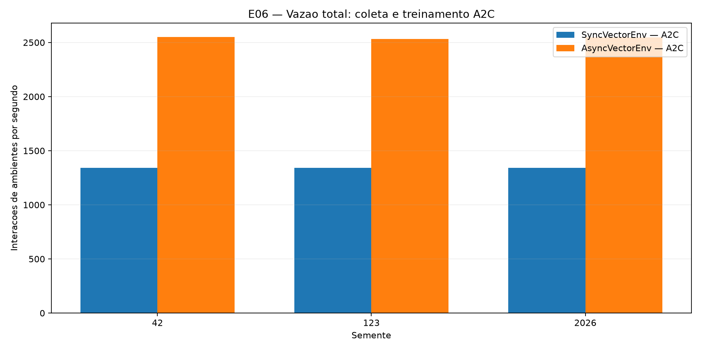
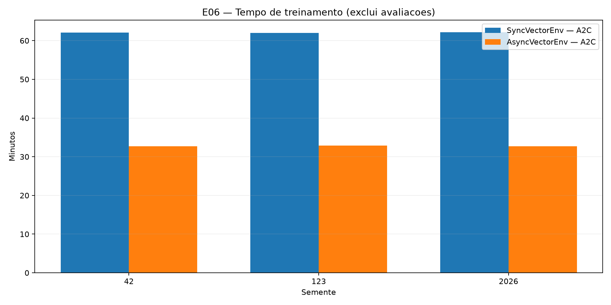
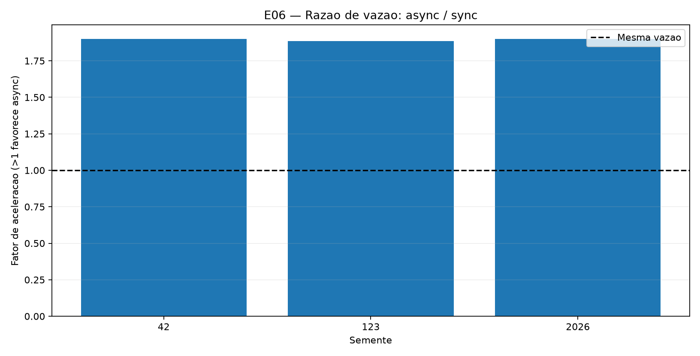
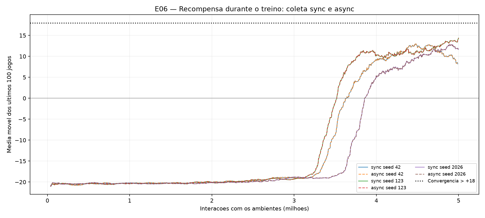
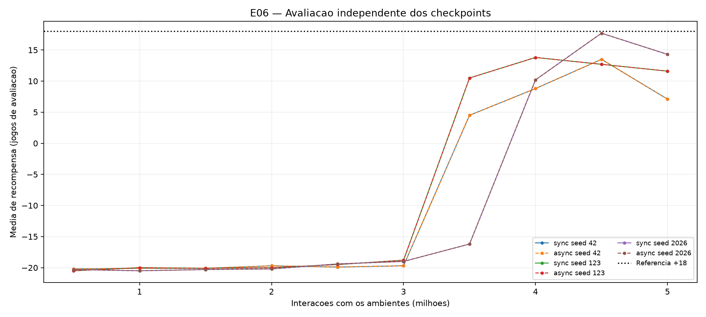
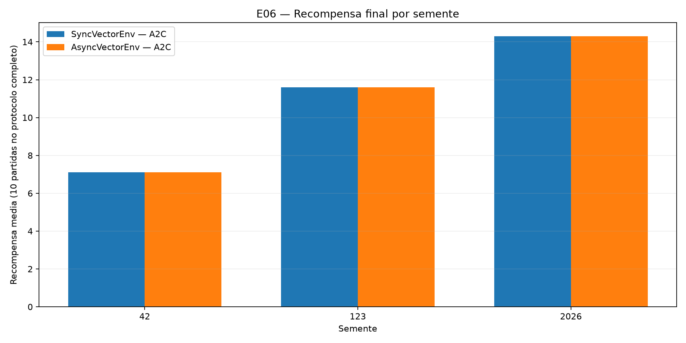
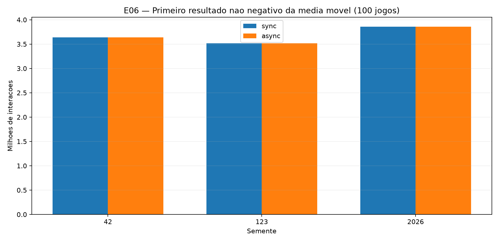

# Experimento E06 — A2C com coleta síncrona e assíncrona no Pong

## 1. Introdução

Este experimento compara o desempenho do algoritmo **Advantage Actor-Critic (A2C)** no ambiente **`PongNoFrameskip-v4`** quando as experiências são coletadas por meio de dois mecanismos de vetorização do Gymnasium: **`SyncVectorEnv`** e **`AsyncVectorEnv`**. A questão experimental é determinar se a execução dos ambientes em subprocessos aumenta a vazão de coleta e treinamento e se essa mudança altera o aprendizado observado sob o mesmo orçamento de interações.

A comparação utiliza os resultados síncronos obtidos anteriormente no **E04**, sem repetir seus treinamentos, e três novas execuções do A2C com coleta assíncrona. Ambas as configurações empregaram as sementes **42, 123 e 2026**, com **5.000.000 de interações por semente**, sem parada antecipada por convergência.

O objetivo principal do E06 é avaliar **eficiência computacional**. O desempenho da política também é acompanhado para verificar se a alteração no mecanismo de coleta produz diferenças nas trajetórias de treinamento ou nas avaliações independentes.

## 2. Fundamentação teórica

O **A2C** combina uma política (*ator*), que determina probabilidades de ações, e uma função de valor (*crítico*), que estima o retorno futuro esperado de um estado. A política é atualizada a partir de estimativas de vantagem, calculadas pela diferença entre o retorno-alvo e o valor estimado:

\[
A_t \approx R_t^{(n)} - V(s_t).
\]

Ambientes vetorizados permitem coletar experiências de diversas instâncias do mesmo jogo. Com **`SyncVectorEnv`**, os ambientes são avançados sequencialmente no processo principal. Com **`AsyncVectorEnv`**, cada ambiente é executado em um subprocesso, possibilitando paralelismo durante a simulação. Na implementação utilizada, o processo principal continua aguardando o **lote de resultados** dos ambientes antes de prosseguir com as atualizações da rede.

Assim, o termo *assíncrono* no E06 descreve a **execução dos ambientes em processos separados**, não a atualização assíncrona de parâmetros. Tanto a inferência da política quanto o cálculo e a aplicação dos gradientes permanecem **centralizados**, diferentemente do paralelismo de gradientes investigado no E07.

Para medir o ganho computacional, define-se o fator de aceleração (*speedup*) da coleta assíncrona em relação à síncrona:

\[
S = \frac{T_{\mathrm{sync}}}{T_{\mathrm{async}}}
  = \frac{V_{\mathrm{async}}}{V_{\mathrm{sync}}},
\]

em que \(T\) representa o tempo de treinamento para um orçamento fixo e \(V\), a vazão de interações por segundo. Valores de \(S>1\) indicam que a configuração assíncrona executou o mesmo orçamento em menos tempo.

## 3. Metodologia experimental

A configuração síncrona foi obtida do **E04**, implementado em `e04_pong.py` a partir de `Chapter12/02_pong_a2c.py`. A configuração assíncrona foi executada por `e06_pong.py`, preservando a arquitetura A2C, os hiperparâmetros e o protocolo de avaliação. O mecanismo assíncrono utiliza `AsyncVectorEnv` com subprocessos e **memória compartilhada** (`shared_memory=True`). Os dois modos utilizaram a GPU **MPS de um Apple M2 Max** para a rede neural.

| Característica | A2C síncrono (E04) | A2C assíncrono (E06) |
|---|---|---|
| Ambiente | `PongNoFrameskip-v4` | `PongNoFrameskip-v4` |
| Vetorização | `SyncVectorEnv` | `AsyncVectorEnv` |
| Execução dos ambientes | Processo principal | Subprocessos |
| Ambientes | 50 | 50 |
| Sementes | 42, 123 e 2026 | 42, 123 e 2026 |
| Orçamento por semente | 5.000.000 interações | 5.000.000 interações |
| Passos vetorizados | 100.000 | 100.000 |
| Atualizações da rede | 39.060 | 39.060 |
| Horizonte do retorno | *n-step* = 4 | *n-step* = 4 |
| Dispositivo da rede | MPS | MPS |
| Parada antecipada | Desabilitada | Desabilitada |
| Avaliações independentes | 10 jogos por checkpoint | 10 jogos por checkpoint |
| Periodicidade | 500.000 interações | 500.000 interações |
| Convergência monitorada | Média dos últimos 100 jogos > +18 | Mesmo critério |

Os resultados síncronos e assíncronos foram agrupados por semente para formar **três pares de comparação**. Cada execução contabilizou chamadas `env.step()` dos **subambientes com *wrappers***. Essa unidade não equivale a quadros brutos do Atari, pois o pré-processamento utiliza *frameskip*.

A vazão foi calculada como a razão entre as 5 milhões de interações e o tempo efetivo de treinamento. Os tempos informados **excluem avaliações independentes e salvamentos de checkpoints**, mas incluem os custos inerentes à coleta, sincronização dos lotes e atualização dos parâmetros. As avaliações empregaram políticas estocásticas, com sementes próprias e protocolo comum.

O desenho experimental é exploratório: cada configuração foi executada uma vez por semente, sem controle rigoroso de processos concorrentes no computador e sem testes inferenciais sobre as diferenças de duração.

## 4. Resultados

### 4.1. Vazão e tempo de treinamento — Gráficos 01, 02 e 03

O **Gráfico 01** apresenta a vazão das seis execuções. O mecanismo assíncrono foi mais rápido em todos os pares, com valores muito semelhantes entre sementes.

| Semente | Sync (int/s) | Async (int/s) | Aceleração |
|---|---:|---:|---:|
| 42 | 1.342,09 | 2.551,49 | 1,901× |
| 123 | 1.343,61 | 2.532,45 | 1,885× |
| 2026 | 1.340,05 | 2.545,63 | 1,900× |
| **Média** | **1.341,92** | **2.543,19** | **1,895×** |

O **Gráfico 02** mostra que o tempo médio por semente caiu de **3.726,02 s (62,10 min)** no modo síncrono para **1.966,05 s (32,77 min)** no modo assíncrono. Isso corresponde a uma economia média de aproximadamente **29,33 minutos por execução**, ou **47,2% do tempo de treinamento**. A redução refere-se ao treinamento, sem contabilizar o custo adicional das avaliações.

O **Gráfico 03** mostra fatores de aceleração próximos de **1,9×** nas três sementes. A dispersão do fator entre as sementes foi pequena (desvio-padrão amostral de aproximadamente **0,009**), indicando regularidade do ganho nas condições observadas, mas não estabelecendo que a mesma aceleração ocorreria com outro hardware ou número de ambientes.

### 4.2. Evolução do aprendizado — Gráfico 04

O **Gráfico 04** sobrepõe as curvas de recompensa média dos últimos 100 jogos de cada semente. Em cada par, as curvas síncrona e assíncrona **coincidem integralmente**. As três sementes permaneceram próximas de **−20 pontos** durante os primeiros milhões de interações e começaram a melhorar rapidamente entre aproximadamente **3,3 e 3,9 milhões**, com velocidades distintas de acordo com a semente.

A conferência dos arquivos de resultados confirmou essa coincidência: os **11.015 registros de episódios de treinamento** do modo síncrono possuem correspondência exata no modo assíncrono, incluindo a ordem das recompensas, os comprimentos dos jogos, as médias móveis e o campo de perda registrado. Isso é compatível com trajetórias determinísticas reproduzidas sob as mesmas sementes e um mecanismo de coleta que entrega os resultados ao processo principal na mesma ordem. Não significa que o processo de simulação tenha sido o mesmo: as configurações indicam mecanismos de vetorização diferentes.

Nenhuma das seis execuções atingiu a **média móvel superior a +18** estabelecida como critério de convergência. A identidade das curvas demonstra que, **nestas execuções**, o paralelismo da coleta não alterou a evolução da recompensa por interação.

### 4.3. Avaliação independente ao longo do treinamento — Gráfico 05

O **Gráfico 05** confirma a coincidência das médias de avaliação dos modos síncrono e assíncrono em todos os checkpoints. Foram **10 checkpoints por semente e por modo**, e os valores médios e os desvios-padrão correspondentes foram idênticos em cada par.

| Semente | Melhor checkpoint observado | Melhor média de avaliação | Média no checkpoint final |
|---|---:|---:|---:|
| 42 | 4,5 milhões | +13,50 | +7,10 |
| 123 | 4,0 milhões | +13,80 | +11,60 |
| 2026 | 4,5 milhões | +17,70 | +14,30 |

As melhores avaliações ocorreram antes do término do orçamento. Como cada checkpoint foi avaliado com apenas **10 jogos**, a escolha do melhor modelo com base nesses valores está sujeita a variabilidade amostral.

### 4.4. Desempenho final — Gráfico 06

O **Gráfico 06** evidencia que não houve diferença de recompensa final dentro de cada par de sementes.

| Semente | Sync (média ± DP) | Async (média ± DP) | Diferença Async − Sync |
|---|---:|---:|---:|
| 42 | +7,10 ± 11,28 | +7,10 ± 11,28 | 0,00 |
| 123 | +11,60 ± 10,44 | +11,60 ± 10,44 | 0,00 |
| 2026 | +14,30 ± 5,08 | +14,30 ± 5,08 | 0,00 |

A **média das três médias de avaliação final** foi **+11,00**, com desvio-padrão de **3,64 entre sementes**, nos dois modos. Os desvios-padrão mostrados por semente representam a dispersão das dez partidas de avaliação, e não a dispersão entre sementes.

### 4.5. Primeiro resultado não negativo — Gráfico 07

O **Gráfico 07** apresenta o primeiro ponto em que a média móvel dos últimos 100 jogos se tornou não negativa. Mais uma vez, os resultados foram idênticos para cada par:

| Semente | Primeira média móvel não negativa |
|---|---:|
| 42 | 3.639.600 interações |
| 123 | 3.519.050 interações |
| 2026 | 3.859.050 interações |

Portanto, **a eficiência amostral medida pelo número de interações até esse marco foi igual** entre os modos. O modo assíncrono, entretanto, alcançou os mesmos marcos em menor tempo de execução graças à maior vazão.

## 5. Discussão

**Aceleração computacional significativa.** O principal achado é o ganho médio de **1,895×** na vazão, acompanhado de redução de **47,2%** no tempo de treinamento. Isso demonstra que, para o Pong com 50 ambientes no computador utilizado, distribuir a execução dos ambientes entre subprocessos foi mais eficiente do que avançá-los sequencialmente no processo principal. O ganho incorpora o balanço entre paralelismo de simulação e custos de comunicação/sincronização; não representa uma aceleração do cálculo dos gradientes isoladamente.

**Preservação exata da trajetória de aprendizado.** O resultado mais forte para a comparabilidade foi a identidade dos registros de episódios e das avaliações independentes nos três pares. A observação é coerente com o fato de ambos os modos aguardarem o conjunto de experiências de cada passo vetorizado, alimentando o mesmo treinamento central com a mesma ordem dos dados. Não se deve concluir, apenas com essa coincidência, que modos assíncronos sempre produzem modelos numericamente idênticos: isso depende da implementação, das sementes, da ordem de entrega dos dados e do comportamento determinístico das operações.

**Eficiência computacional versus eficiência amostral.** O E06 não demonstrou melhora no aprendizado **por interação**: a primeira média móvel não negativa, a evolução das recompensas e as avaliações foram iguais. Demonstrou, sim, maior eficiência **por unidade de tempo**, pois o modo assíncrono executou as mesmas experiências mais rapidamente. Essas duas noções de eficiência devem permanecer separadas.

**Coleta assíncrona não é atualização assíncrona dos parâmetros.** Embora utilize `AsyncVectorEnv`, esta configuração continua sendo A2C: a rede e o otimizador permanecem no processo principal. Não há trabalhadores treinando cópias próprias da política nem enviando gradientes defasados. A análise do paralelismo no cálculo de gradientes pertence ao **E07**, cujo mecanismo é diferente.

**Limitações metodológicas.** O estudo contemplou três sementes, apenas uma quantidade de ambientes (**50**), um único jogo e um computador. Os tempos de treinamento foram obtidos em execuções distintas e não foram controlados quanto à interferência de outros processos. O número de sementes é adequado a uma comparação exploratória, mas insuficiente para generalizar o ganho para outros ambientes, arquiteturas ou equipamentos. As avaliações de desempenho da política usaram somente dez partidas por checkpoint; além disso, nenhuma execução satisfez o critério formal de convergência. Por fim, as métricas de vazão excluem o tempo de avaliação e salvamento de checkpoints, de modo que o ganho no tempo total de ponta a ponta pode ser ligeiramente diferente.

## 6. Conclusões

O experimento E06 mostrou que o uso de **`AsyncVectorEnv`** com 50 ambientes elevou a vazão média do A2C de **1.341,92 para 2.543,19 interações/s**, com **aceleração média de 1,895×** e redução de **47,2%** do tempo de treinamento frente a `SyncVectorEnv`.

A alteração do mecanismo de coleta **não modificou os resultados de aprendizado observados**: os registros de episódios, as curvas de recompensa, as médias das avaliações por checkpoint e os marcos de desempenho foram idênticos em cada uma das três sementes. A recompensa média final de avaliação permaneceu em **+11,00**, e nenhuma execução atingiu o critério de convergência superior a +18 na média dos últimos 100 jogos.

Conclui-se que, **nesta configuração e neste hardware**, o paralelismo na execução dos ambientes melhorou substancialmente a eficiência computacional, sem evidência de alteração da eficiência amostral. O E06 constitui, assim, uma referência para o estudo posterior do paralelismo de gradientes no **A3C (E07)**.
