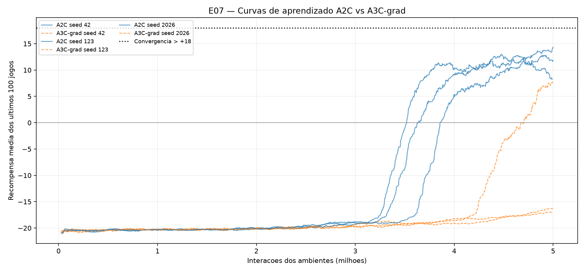
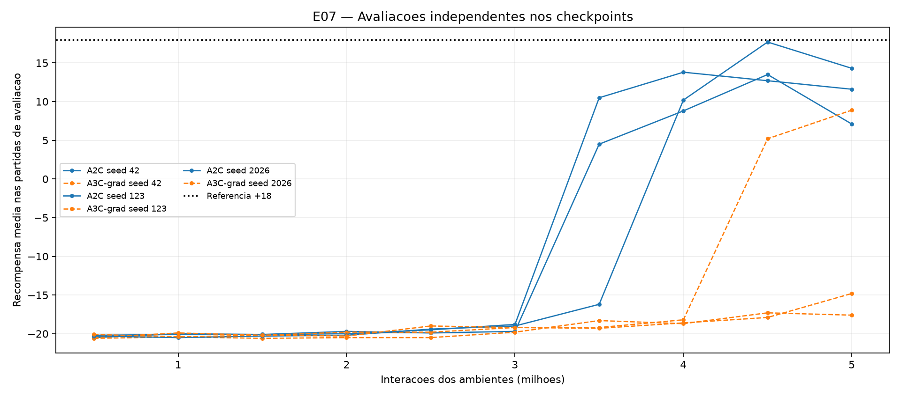
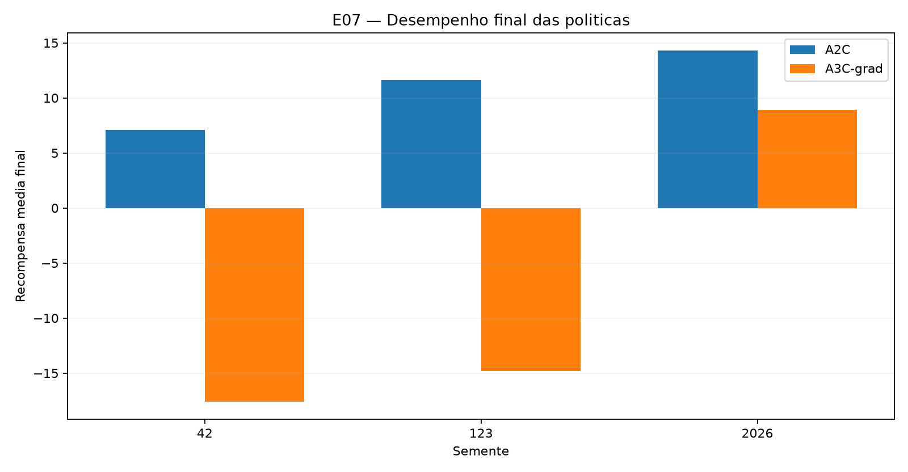
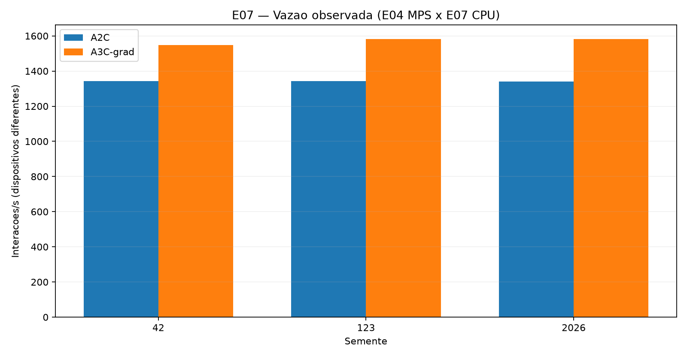
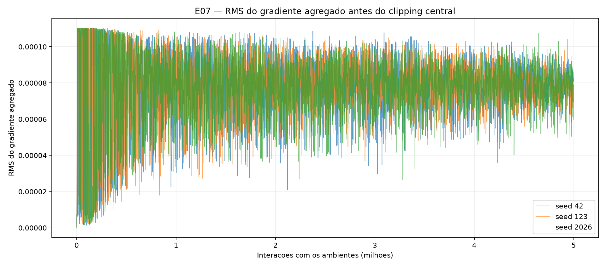
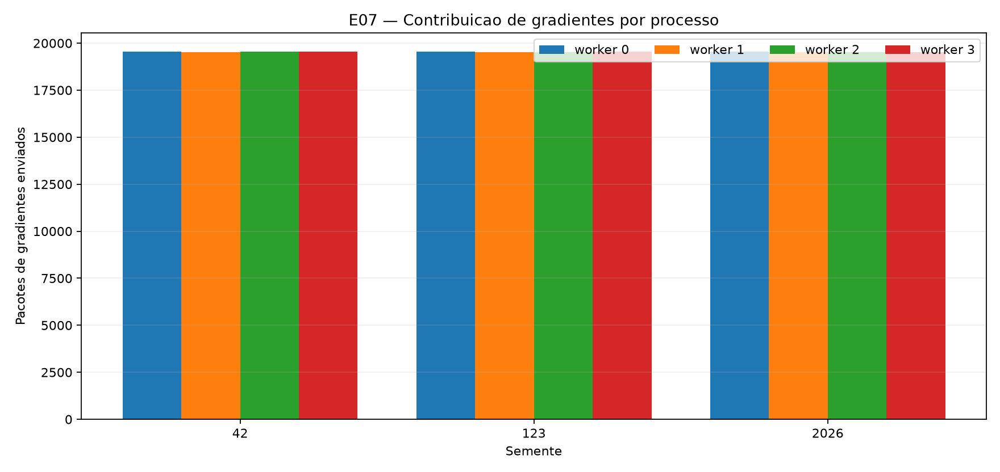
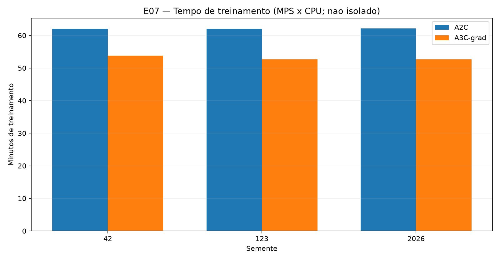
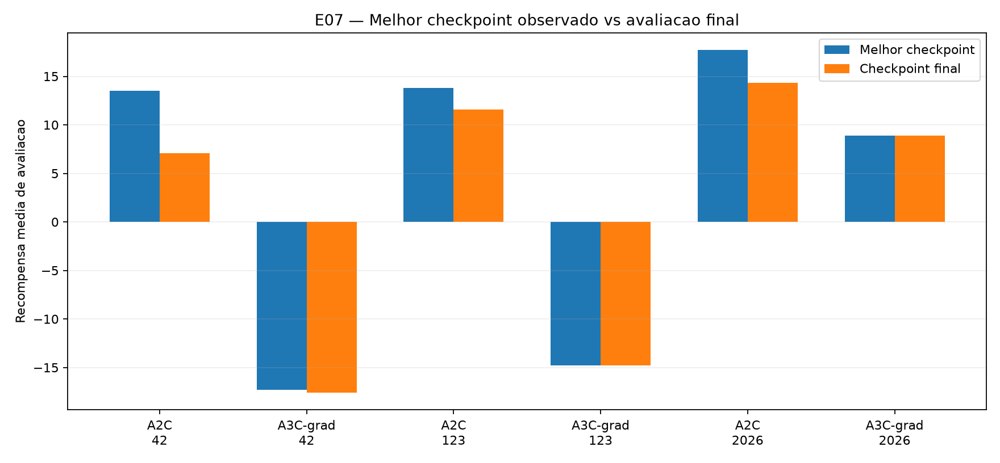

# Experimento E07 — A3C-grad com múltiplos processos versus A2C no Pong

## 1. Introdução

O experimento E07 investiga o treinamento de uma política *Actor-Critic* com **cálculo de gradientes distribuído entre processos**, utilizando a variante **A3C-grad**, baseada no exemplo `Chapter12/03_a3c_grad.py` de *Deep Reinforcement Learning Hands-On*. Como referência, reutilizam-se os resultados do **A2C síncrono do E04**, baseado no exemplo `Chapter12/02_pong_a2c.py`.

A questão experimental é verificar como as implementações se comportam quanto à **evolução do aprendizado**, ao **desempenho final** e ao **custo de execução**, sob orçamento semelhante de interações no ambiente `PongNoFrameskip-v4`. Também se observa a distribuição das contribuições de gradientes entre os trabalhadores (*workers*).

Foram utilizadas as sementes **42, 123 e 2026**, com orçamento nominal de **5.000.000 de interações por execução** e **sem parada antecipada por convergência**. A comparação não pretende isolar exclusivamente o efeito do processamento assíncrono: há diferenças de dispositivo, número de ambientes e organização dos lotes entre E04 e E07.

## 2. Fundamentação teórica

### 2.1. Actor-Critic e estimativa de vantagem

Os métodos *Actor-Critic* utilizam uma política parametrizada \(\pi_\theta(a\mid s)\), que define as probabilidades das ações, e um crítico que estima o valor de um estado \(V_\phi(s)\). Na implementação estudada, o sinal do ator depende da vantagem estimada, definida pela diferença entre um retorno-alvo e o valor previsto pelo crítico:

\[
A_t \approx R_t^{(n)}-V_\phi(s_t).
\]

Uma representação simplificada das perdas é:

\[
L_{\mathrm{actor}}=-\mathbb{E}\!\left[A_t\log\pi_\theta(a_t\mid s_t)\right],
\]

\[
L_{\mathrm{critic}}=\mathbb{E}\!\left[(R_t^{(n)}-V_\phi(s_t))^2\right],
\]

\[
L_{\mathrm{total}}=L_{\mathrm{actor}}+L_{\mathrm{critic}}-\beta H(\pi_\theta).
\]

O termo de entropia \(H\) ajuda a evitar a concentração prematura da distribuição de probabilidades das ações. Os gradientes dessas perdas em relação aos parâmetros da rede orientam sua atualização pelo otimizador.

### 2.2. A2C e A3C-grad

No **A2C do E04**, um conjunto de **50 ambientes síncronos** produz experiências; o cálculo dos gradientes e a atualização dos parâmetros são realizados em um processo central, no dispositivo **MPS** do Mac.

No **A3C-grad do E07**, **quatro processos** executam **oito ambientes cada**. Cada trabalhador utiliza uma cópia local dos parâmetros, calcula gradientes a partir das experiências coletadas e envia seus resultados ao processo principal. Esse processo agrega **dois pacotes de gradientes** antes de realizar a atualização com Adam sobre o modelo compartilhado em **CPU**. As cópias locais podem utilizar versões diferentes dos parâmetros globais, conforme o andamento dos processos.

Essa implementação **não é o A3C clássico com atualizações concorrentes diretas sobre os parâmetros compartilhados** (*Hogwild!*): a aplicação de gradientes é centralizada. Também difere do E06, em que o `AsyncVectorEnv` paraleliza apenas a execução dos ambientes, mantendo o cálculo dos gradientes no processo principal.

O desempenho computacional é apresentado em interações com os subambientes por segundo. Uma interação representa uma chamada a `env.step` nos ambientes com *wrappers*, e não necessariamente um quadro bruto do emulador Atari.

## 3. Metodologia experimental

### 3.1. Configurações e protocolos

| Característica | A2C — E04 | A3C-grad — E07 |
|---|---|---|
| Ambiente | `PongNoFrameskip-v4` | `PongNoFrameskip-v4` |
| Referência | `Chapter12/02_pong_a2c.py` | `Chapter12/03_a3c_grad.py` |
| Paralelismo | 50 ambientes síncronos | 4 workers × 8 ambientes |
| Cálculo dos gradientes | Processo central | Workers independentes |
| Aplicação dos gradientes | Processo central | Processo central, após agregação |
| Lotes | Lote de 128 experiências | 64 experiências por pacote; 2 pacotes por atualização |
| Dispositivo de treinamento | MPS | CPU |
| Sementes | 42, 123, 2026 | 42, 123, 2026 |
| Orçamento nominal | 5.000.000 interações | 5.000.000 interações |
| Avaliações independentes | 10 jogos por checkpoint | 10 jogos por checkpoint |
| Periodicidade da avaliação | 500.000 interações | 500.000 interações |
| Parada por convergência | Desativada | Desativada |

O treinamento do A2C não foi repetido: foram utilizados os resultados já obtidos no E04. No E07, os trabalhadores mantêm cópias locais da rede; o processo central aplica Adam sobre os parâmetros compartilhados. A implementação corrige a dimensão da vantagem com `squeeze(-1)`, evitando o *broadcasting* indevido presente no exemplo de referência, e registra métricas de gradientes e de participação de cada trabalhador.

O orçamento do A3C-grad foi ultrapassado marginalmente (**192 a 232 interações**) porque há pacotes em trânsito entre os processos quando o limite é detectado. Essa diferença é inferior a 0,005% do orçamento e não altera materialmente a comparação.

### 3.2. Critérios de avaliação

Foram observados: recompensa média móvel dos últimos **100 jogos**, recompensa média de **10 jogos independentes** em cada checkpoint, primeira média móvel não negativa, critério formal de convergência (média móvel **maior que +18**), vazão de interações, tempo de treinamento excluindo avaliações, magnitude RMS dos gradientes agregados e número de pacotes de gradientes enviados por trabalhador.

O desvio-padrão informado ao lado das avaliações finais corresponde aos **dez jogos** da respectiva execução. Quando calculado entre sementes, é identificado separadamente. O protocolo usa políticas estocásticas, de modo que uma avaliação com dez partidas tem incerteza relevante.

## 4. Resultados

### 4.1. Resultados por execução

| Método | Semente | Jogos de treino | Média móvel final (100) | Avaliação final (média ± DP) | Melhor checkpoint (interações) |
|---|---:|---:|---:|---:|---:|
| A2C | 42 | 3.621 | +8,20 | +7,10 ± 11,28 | +13,50 (4,5 M) |
| A3C-grad | 42 | 4.234 | −16,92 | −17,60 ± 1,90 | −17,30 (4,5 M) |
| A2C | 123 | 3.595 | +14,37 | +11,60 ± 10,44 | +13,80 (4,0 M) |
| A3C-grad | 123 | 4.013 | −16,31 | −14,80 ± 2,86 | −14,80 (5,0 M) |
| A2C | 2026 | 3.799 | +11,82 | +14,30 ± 5,08 | +17,70 (4,5 M) |
| A3C-grad | 2026 | 4.226 | +7,65 | +8,90 ± 9,94 | +8,90 (5,0 M) |

A recompensa média das avaliações finais foi **+11,00** para o A2C e **−7,83** para o A3C-grad. A diferença observada foi de **18,83 pontos** em favor do A2C, nas três sementes pareadas. Os desvios-padrão *entre as três médias finais por semente* foram **3,64** no A2C e **14,56** no A3C-grad, indicando maior dispersão entre execuções do A3C-grad nessa amostra.

Nenhuma execução de qualquer método satisfez o critério formal de média móvel maior que **+18**. A média móvel se tornou não negativa nas **três** sementes do A2C, mas somente na semente **2026** do A3C-grad.

### 4.2. Evolução das recompensas de treinamento — Gráfico 01

O **Gráfico 01** evidencia trajetórias distintas. As três sementes do A2C iniciaram com recompensas próximas de −20 e passaram a melhorar rapidamente por volta de **3,3 a 3,9 milhões de interações**, encerrando com média móvel positiva. O A3C-grad permaneceu com médias negativas nas sementes **42** e **123**, embora tenha apresentado melhora gradual, especialmente após aproximadamente 4 milhões de interações.

A semente **2026** do A3C-grad exibiu uma mudança tardia de comportamento: sua média móvel tornou-se não negativa em aproximadamente **4.703.104 interações** e terminou em **+7,65**. Isso demonstra capacidade de aprendizado na implementação utilizada, mas com maior dependência da semente e menor eficiência amostral observada do que no A2C. No E07, os instantes associados aos jogos representam o contador agregado quando o processo central recebeu pacotes; não são marcas temporais exatas do encerramento de cada partida.

### 4.3. Avaliação independente por checkpoint — Gráfico 02

O **Gráfico 02** confirma o contraste nas avaliações de dez jogos por checkpoint. A partir de **3,5 milhões de interações**, o A2C já apresentou avaliações positivas nas sementes 42 e 123; a semente 2026 melhorou nas avaliações seguintes. O A3C-grad manteve médias negativas nas sementes 42 e 123 em todos os checkpoints. Na semente 2026, passou de **−18,20** em 4 milhões para **+5,20** em 4,5 milhões e **+8,90** no final.

| Interações | A3C-grad 42 | A3C-grad 123 | A3C-grad 2026 |
|---:|---:|---:|---:|
| 3,0 milhões | −19,80 | −19,20 | −19,20 |
| 3,5 milhões | −18,30 | −19,30 | −19,20 |
| 4,0 milhões | −18,70 | −18,60 | −18,20 |
| 4,5 milhões | −17,30 | −17,90 | +5,20 |
| 5,0 milhões | −17,60 | −14,80 | +8,90 |

A avaliação final da semente 2026 teve desvio-padrão de **9,94 pontos**, mostrando variação considerável entre as dez partidas. Portanto, sua melhora é relevante na execução observada, mas o desempenho esperado da política ainda é estimado com precisão limitada.

### 4.4. Desempenho final pareado — Gráfico 03

O **Gráfico 03** permite comparar diretamente as médias finais:

| Semente | A2C | A3C-grad | Diferença (A3C-grad − A2C) |
|---:|---:|---:|---:|
| 42 | +7,10 | −17,60 | −24,70 |
| 123 | +11,60 | −14,80 | −26,40 |
| 2026 | +14,30 | +8,90 | −5,40 |
| **Média** | **+11,00** | **−7,83** | **−18,83** |

O A2C terminou com média superior em todas as três sementes. A diferença foi particularmente elevada nas sementes 42 e 123. Entretanto, o pareamento dos identificadores de semente não controla as diferenças de arquitetura de execução, dispositivo, número de ambientes e experiência efetivamente coletada.

### 4.5. Vazão observada — Gráfico 04

| Semente | A2C (interações/s) | A3C-grad (interações/s) | Razão A3C-grad / A2C |
|---:|---:|---:|---:|
| 42 | 1.342,09 | 1.548,86 | 1,154× |
| 123 | 1.343,61 | 1.581,46 | 1,177× |
| 2026 | 1.340,05 | 1.583,13 | 1,181× |
| **Média** | **1.341,92** | **1.571,15** | **1,171×** |

O **Gráfico 04** apresenta vazão aproximadamente **17,1% maior** no A3C-grad. O indicador é descritivo do sistema completo: **A2C executou em MPS com 50 ambientes**, ao passo que **A3C-grad executou em CPU com 32 ambientes distribuídos em quatro processos**. Logo, **não é correto atribuir os 17,1% exclusivamente à estratégia de paralelização dos gradientes**. As diferenças de composição dos lotes e de uso de CPU/GPU também afetam esse resultado.

### 4.6. Magnitude dos gradientes agregados — Gráfico 05

O **Gráfico 05** registra a magnitude RMS dos componentes do gradiente agregado recebido pelo processo central, **antes do clipping central**:

\[
\operatorname{RMS}(g)=\sqrt{\frac{1}{N}\sum_{i=1}^{N}g_i^2}.
\]

A magnitude apresentou oscilações frequentes e permaneceu geralmente na ordem de \(10^{-5}\) a \(10^{-4}\). Há uma fase inicial de maior dispersão, seguida de valores concentrados ao redor de **\(8\times10^{-5}\)**, sem ruptura abrupta correspondente ao aprendizado tardio da semente 2026.

O gráfico demonstra que os gradientes foram produzidos e agregados durante todo o treinamento, mas **não permite inferir sua qualidade apenas pela magnitude**. Em particular, gradientes de tamanho parecido podem apontar para direções distintas, com impactos diferentes na política. A implementação realiza limitação de norma nos workers e novamente após a agregação central; a métrica exibida refere-se ao gradiente agregado antes dessa segunda limitação.

### 4.7. Contribuição dos processos — Gráfico 06

O **Gráfico 06** mostra participação praticamente equilibrada dos quatro workers. Cada processo enviou cerca de **19,5 mil pacotes de gradientes** por semente, representando aproximadamente **1,25 milhão de interações** de ambientes. Entre o worker com mais e com menos pacotes, a diferença foi de apenas **32** pacotes na semente 42, **34** na 123 e **43** na 2026.

Esse equilíbrio indica que a coleta e a produção de pacotes foram distribuídas de modo uniforme entre os workers. Não significa, porém, que os gradientes tenham contribuído igualmente em direção, qualidade ou efeito sobre a atualização dos pesos.

### 4.8. Tempo de treinamento — Gráfico 07

| Semente | A2C (min) | A3C-grad (min) |
|---:|---:|---:|
| 42 | 62,09 | 53,81 |
| 123 | 62,02 | 52,70 |
| 2026 | 62,19 | 52,64 |
| **Média** | **62,10** | **53,05** |

O **Gráfico 07** apresenta uma redução observada de aproximadamente **9,05 minutos**, ou **14,6%**, no tempo médio necessário para consumir o orçamento nominal. Os tempos excluem a duração das avaliações e dos checkpoints, mas não isolam diferenças de dispositivo e outras condições de execução.

Portanto, o A3C-grad consumiu o orçamento em menos tempo nesta configuração, mas apresentou aprendizado substancialmente inferior na maioria das sementes. **Menor duração de treinamento não implicou melhor desempenho da política.**

### 4.9. Melhor checkpoint versus avaliação final — Gráfico 08

O **Gráfico 08** evidencia que o melhor checkpoint observado no A3C-grad ocorreu em **4,5 milhões** de interações para a semente 42 (−17,30) e no **final** para as sementes 123 (−14,80) e 2026 (+8,90). Para o A2C, os melhores checkpoints observados foram anteriores ao final: 4,5 milhões (42 e 2026) e 4 milhões (123).

Isso sugere que as execuções do A3C-grad, especialmente as sementes 123 e 2026, **ainda estavam melhorando ao atingir o orçamento**, enquanto o A2C alcançou desempenhos elevados antes. Não se pode afirmar que prolongar o treinamento do A3C-grad levaria necessariamente à convergência. Além disso, a escolha do “melhor” checkpoint entre avaliações de apenas dez jogos sofre incerteza amostral.

## 5. Discussão

Os resultados permitem destacar cinco interpretações principais.

**Primeiro, o A2C apresentou maior eficiência amostral nas configurações avaliadas.** Com o mesmo orçamento nominal, obteve médias móveis positivas nas três sementes e avaliações finais superiores em todos os pares. O A3C-grad só alcançou recompensa média móvel não negativa na semente 2026, perto de 4,7 milhões de interações. Isso não implica que todo método A3C seja inferior ao A2C; demonstra o comportamento específico das implementações e hiperparâmetros empregados.

**Segundo, o A3C-grad mostrou maior sensibilidade à semente.** Suas médias finais variaram de −17,60 a +8,90, enquanto o A2C ficou entre +7,10 e +14,30. Essa dispersão, com apenas três sementes, é uma evidência exploratória de variabilidade entre execuções, não uma estimativa estatística conclusiva da robustez dos algoritmos.

**Terceiro, o paralelismo funcionou do ponto de vista operacional.** Os quatro workers produziram quantidades similares de pacotes de gradientes, o processo central realizou aproximadamente **39.061 atualizações** por semente e as três execuções terminaram sem falhas. O equilíbrio entre workers valida a participação efetiva dos processos, mas não basta para garantir eficiência do aprendizado.

**Quarto, a vantagem de vazão do A3C-grad é uma medição do conjunto algoritmo–hardware–implementação.** O A3C-grad obteve cerca de 17% mais interações/s, apesar de usar CPU, mas as configurações não são equivalentes: diferem em número de ambientes, organização dos lotes e dispositivo. O resultado não isola o custo da comunicação entre processos nem permite estimar o *speedup* causado exclusivamente pelo cálculo distribuído dos gradientes. O E06 constitui uma comparação mais direta de mecanismos de coleta, pois mantém a configuração do A2C e muda somente o tipo de ambiente vetorizado.

**Quinto, a interpretação do A3C-grad deve respeitar sua implementação específica.** Há cópias locais dos parâmetros e cálculo independente de gradientes, mas as atualizações são realizadas por um único processo com Adam. Essa abordagem não reproduz integralmente o A3C clássico com atualizações diretas concorrentes. Além disso, a correção da dimensão da vantagem foi necessária para impedir um produto por *broadcasting* incorreto na função de perda.

Como limitações, destacam-se: três sementes; avaliações de apenas dez partidas por checkpoint; diferenças de dispositivo e número de ambientes; observações de treinamento registradas no processo central conforme a chegada dos pacotes; e orçamento fixo que pode interromper uma trajetória ainda ascendente. Nenhuma dessas limitações invalida os resultados descritivos, mas restringe as conclusões causais e de generalização.

## 6. Conclusões

O E07 implementou e avaliou com sucesso uma variante **A3C-grad** com **quatro workers**, cada um operando **oito ambientes Pong**, e um processo central responsável por agregar os gradientes e atualizar o modelo.

Nas três sementes analisadas, o **A2C do E04 superou o A3C-grad em recompensa final**. A média das avaliações finais foi **+11,00** contra **−7,83**, diferença de **18,83 pontos**. O A3C-grad obteve progresso expressivo apenas na semente 2026, com recompensa final **+8,90** e início tardio da fase de aprendizado positivo.

Do ponto de vista computacional, o A3C-grad registrou vazão média **1.571,15 interações/s**, frente a **1.341,92 interações/s** do A2C, porém em condições distintas de hardware e paralelismo. Assim, o resultado deve ser apresentado como **desempenho observado das duas implementações**, e não como medida isolada de superioridade computacional da arquitetura A3C.

O experimento reforça a distinção entre **paralelizar a geração dos gradientes**, **reduzir tempo de execução** e **aprender uma política melhor**: os três objetivos não são equivalentes, e nenhum ganho de paralelismo garante, por si só, convergência superior.

---

**Referências de implementação e dados:** `Chapter12/02_pong_a2c.py`, `Chapter12/03_a3c_grad.py`, `e04_pong.py`, `e07_pong.py` e os arquivos `resumo_analise.json`, `resumo_execucoes.csv`, `resumo_checkpoints.csv`, `comparacao_pareada.csv`, `atualizacoes_a3c.csv` e `contribuicoes_workers.csv` da análise E07. Os oito gráficos mencionados correspondem aos arquivos produzidos por `analise_e07.py`.
